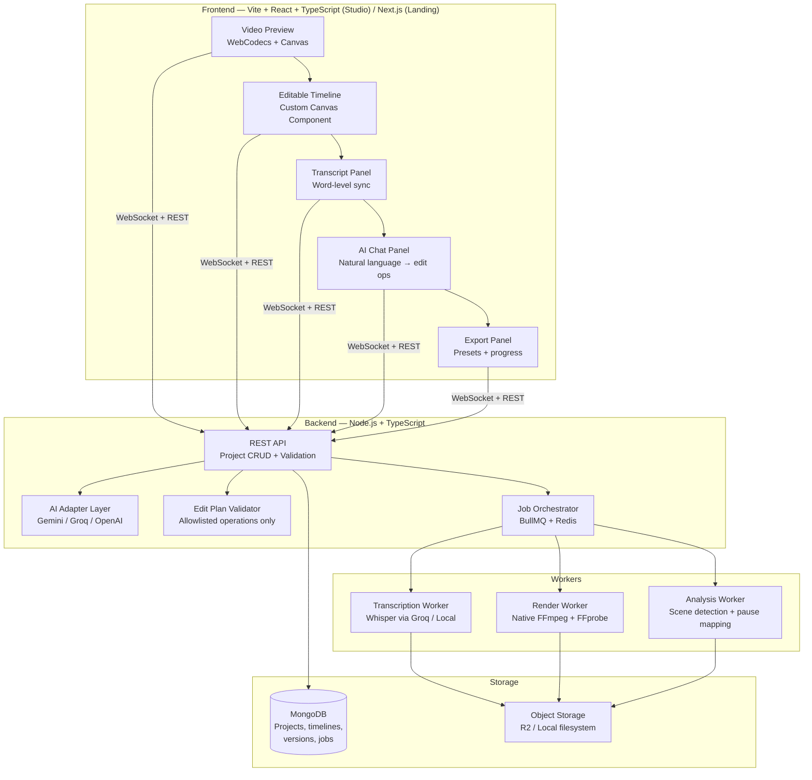

# 🎬 Vid-Edi — AI Video Studio
## Final Project Plan v1.0

> **One-liner:** An open-source, AI-assisted video editor where you describe edits in plain language, the AI proposes transparent changes to a real timeline, and a deterministic media engine renders the final video.

---

## Table of Contents

1. [Product Vision & Target Audience](#1-product-vision--target-audience)
2. [Competitive Intelligence & Differentiation](#2-competitive-intelligence--differentiation)
3. [Architecture & Tech Stack](#3-architecture--tech-stack)
4. [Data Models & Core Abstractions](#4-data-models--core-abstractions)
5. [Feature Matrix — What Ships When](#5-feature-matrix--what-ships-when)
6. [Phased Execution Roadmap](#6-phased-execution-roadmap)
7. [AI Edit Planner — The Core Differentiator](#7-ai-edit-planner--the-core-differentiator)
8. [Skills Activation Map](#8-skills-activation-map)
9. [Zero-Budget Infrastructure Plan](#9-zero-budget-infrastructure-plan)
10. [Quality, Testing & DevOps Strategy](#10-quality-testing--devops-strategy)
11. [Risk Register & Mitigations](#11-risk-register--mitigations)
12. [Post-MVP Roadmap](#12-post-mvp-roadmap)

---

## 1. Product Vision & Target Audience

### The Problem
Spoken-content creators (talking-head YouTubers, podcasters, interviewers, educators, screen-recorders) have a recurring pain: a 45-minute recording contains 8 minutes of dead air, 3 repeated takes, and zero captions. Getting a "good first edit" takes hours of manual scrubbing.

### The Solution
Vid-Edi takes them through five steps:

```
┌─────────────────────────────────────────────────────────────┐
│  1. IMPORT   →  Drop a video file, inspect properties       │
│  2. UNDERSTAND  →  Transcript + scene markers + pause map   │
│  3. ASK      →  "Remove pauses, add captions, find Shorts"  │
│  4. REVIEW   →  See every proposed cut with reason + undo   │
│  5. EXPORT   →  MP4, SRT, vertical clips, edit-plan JSON    │
└─────────────────────────────────────────────────────────────┘
```

### Why Spoken Content First
- **The transcript is the edit map.** For talking-head content, word timestamps give us strong evidence for cuts, highlights, captions, and clip boundaries — no computer vision required.
- **Cinematic footage, multi-cam, action videos** rely on visual context that transcript alone can't resolve. We add that later.
- This is a *starting audience*, not a permanent product constraint.

### Primary User Personas

| Persona | Use Case | Key Need |
|---------|----------|----------|
| **Solo YouTuber** | 30-min talking-head → polished 12-min upload | Remove pauses, add captions, suggest cuts |
| **Podcast Editor** | Interview → highlight clips for social | Find 3-5 best moments as vertical Shorts |
| **Educator** | Screen recording + voiceover | Clean up retakes, add chapter markers |
| **Content Repurposer** | Long-form → multiple platform clips | Batch vertical clips with branded captions |

---

## 2. Competitive Intelligence & Differentiation

### Landscape (October 2026)

| Product | Strengths | Gaps We Exploit |
|---------|-----------|-----------------|
| **Descript** | Transcript editing, filler removal, AI co-editor | Proprietary, $24+/mo, opaque AI decisions, no self-hosting |
| **OpusClip** | Great short-clip extraction, viral scoring | Cloud-only, monthly credit limits, no full editor |
| **CutScript** (OSS) | Local Descript clone, WhisperX, Electron | No AI edit planner, no structured edit plans, basic timeline |
| **OpenCut AI** (OSS) | Smart cut, B-roll matching, dubbing | Self-hosted complexity, no natural-language edit commands |
| **OpenReel** (OSS) | AI agent controls timeline | Early-stage, limited feature set |

### Our Four Differentiators

> [!IMPORTANT]
> These are not marketing slogans — they are architectural commitments that every engineering decision must support.

1. **🔍 Every AI change is visible.** Cuts show source time ranges, explanations, and confidence. No silent black-box edits.
2. **✋ Human control comes first.** Every proposal can be accepted, modified, rejected, or undone. The AI suggests; the human decides.
3. **📋 Edit plans are reproducible.** Save timeline operations + export settings as JSON. Re-render the same project identically.
4. **💰 Cost-conscious processing.** Deterministic FFmpeg for heavy work. AI only proposes operations — never generates or re-encodes footage.

### What We Are NOT Building
- ❌ A Premiere Pro / DaVinci Resolve replacement
- ❌ A generative video tool (no Sora / Runway-style generation)
- ❌ A real-time collaborative editor (that's V3+)
- ❌ An unlimited free cloud processing service

---

## 3. Architecture & Tech Stack

### High-Level Architecture



### Tech Stack Decisions

| Layer | Choice | Rationale |
|-------|--------|-----------|
| **Editor app** | Vite + React 19 + TypeScript | Pure client-side SPA — lighter, faster HMR, no SSR overhead for a canvas-heavy editor. |
| **Landing page** | Next.js 15 (App Router) + TypeScript | SSR for marketing/SEO. Separate app in monorepo. |
| **Timeline rendering** | Custom HTML5 Canvas component | No existing library matches our needs for AI-annotated clips. We own the interaction model. |
| **Video preview** | WebCodecs API + `<canvas>` | Hardware-accelerated decoding, frame-accurate seeking. Fallback to `<video>` element for basic playback. |
| **Audio waveforms** | WaveSurfer.js | Industry standard. Timeline plugin for time ruler sync. |
| **State management** | Zustand + Immer | Lightweight, supports undo/redo via middleware, works well with complex nested timeline state. |
| **Backend runtime** | Node.js 22 LTS + TypeScript | Shared types with frontend. Native `fetch`, `crypto`, stream APIs. |
| **API framework** | tRPC (or Express + Zod) | End-to-end type safety between frontend and backend. |
| **Job queue** | BullMQ + Redis | Progress tracking, retry logic, flow orchestration for multi-step renders. |
| **Database** | MongoDB (Mongoose ODM) | Flexible schema for timeline operations, version snapshots, project metadata. |
| **Media processing** | Native FFmpeg 7.x + FFprobe | Cuts, overlays, effects, audio mixing, encoding. Deterministic and free. |
| **Speech-to-text** | Groq Whisper API (primary) + local Whisper fallback | Word-level timestamps, 25MB chunk limit handled with overlap strategy. |
| **AI planner** | Gemini Flash (primary) → Groq Llama (backup) → Ollama (offline) | Structured JSON output for edit operations. Provider adapter pattern — swappable. |
| **Monorepo** | Turborepo + pnpm workspaces | Parallel builds, shared packages, caching. |
| **Styling** | Tailwind CSS 4 + Radix UI primitives | Dual theme (light default + dark). Accessible by default. |

### Monorepo Structure

```
vid-edi/
├── apps/
│   ├── web/                    # Next.js — Landing page, marketing, SEO
│   └── studio/                 # Vite + React — Editor workspace (timeline, preview, AI)
├── packages/
│   ├── editor-engine/          # Timeline state, undo/redo, clip operations (framework-agnostic)
│   ├── ai-planner/             # AI provider adapters, prompt templates, response parsing
│   ├── media-processing/       # FFmpeg/FFprobe wrappers, WebCodecs utilities
│   ├── shared-types/           # TypeScript types shared across all packages
│   ├── ui/                     # Shared design system components
│   └── config/                 # Shared ESLint, TypeScript, Tailwind configs
├── workers/
│   ├── transcription/          # Whisper transcription worker
│   ├── render/                 # FFmpeg render worker
│   └── analysis/               # Scene detection, pause mapping
├── pnpm-workspace.yaml
├── turbo.json
├── docker-compose.yml          # Redis + MongoDB for local dev
└── package.json
```

---

## 4. Data Models & Core Abstractions

### The Edit Plan — Most Important Data Structure

```typescript
// packages/shared-types/src/edit-plan.ts

/** A single atomic edit operation */
interface EditOperation {
  id: string;
  type: EditOperationType;
  /** Source clip/track reference */
  target: {
    clipId: string;
    trackId: string;
  };
  /** Time range in source media (seconds) */
  sourceRange?: {
    start: number;
    end: number;
  };
  /** Operation-specific parameters */
  params: Record<string, unknown>;
  /** Why the AI suggested this (empty for manual edits) */
  reason?: string;
  /** Confidence score 0-1 (AI operations only) */
  confidence?: number;
  /** User decision */
  status: 'proposed' | 'accepted' | 'rejected' | 'modified';
}

type EditOperationType =
  | 'splitClip'
  | 'trimClip'
  | 'removeSegment'
  | 'reorderClip'
  | 'addCaption'
  | 'removeCaption'
  | 'setAspectRatio'
  | 'setCropRegion'
  | 'adjustVolume'
  | 'muteSegment'
  | 'addFade'
  | 'addTransition'
  | 'setPlaybackRate'
  | 'addOverlay'
  | 'applyFilter'
  | 'mixAudio'
  | 'insertClip';
```

### Timeline Model

```typescript
interface Project {
  id: string;
  name: string;
  createdAt: Date;
  updatedAt: Date;
  /** Original source media files */
  sources: MediaSource[];
  /** Current timeline state */
  timeline: Timeline;
  /** Named version snapshots */
  versions: Version[];
  /** Full operation history */
  history: EditOperation[];
  /** Export settings */
  exportPresets: ExportPreset[];
  /** Project analytics */
  analytics: ProjectAnalytics;
}

interface Timeline {
  /** Total duration in seconds */
  duration: number;
  /** Output dimensions */
  resolution: { width: number; height: number };
  /** Frames per second */
  fps: number;
  /** Ordered list of tracks */
  tracks: Track[];
}

interface Track {
  id: string;
  type: 'video' | 'audio' | 'caption' | 'overlay';
  name: string;
  clips: Clip[];
  muted: boolean;
  locked: boolean;
  volume: number; // 0-1, for audio tracks
}

interface Clip {
  id: string;
  /** Reference to source media */
  sourceId: string;
  /** Where this clip starts in the source (seconds) */
  sourceStart: number;
  /** Where this clip ends in the source (seconds) */
  sourceEnd: number;
  /** Position on the output timeline (seconds) */
  timelineStart: number;
  /** Computed: sourceEnd - sourceStart / playbackRate */
  timelineDuration: number;
  /** Applied effects */
  effects: Effect[];
  /** Playback speed multiplier */
  playbackRate: number;
  /** Volume (0-1) */
  volume: number;
  /** Transition to next clip */
  transition?: Transition;
}
```

### Three-Layer Separation

```
┌──────────────────────────────────────────────┐
│  Layer 1: AI PLANNER                         │
│  "What edit to propose"                       │
│  Input: transcript + timecodes + user prompt │
│  Output: EditOperation[]                      │
├──────────────────────────────────────────────┤
│  Layer 2: APPLICATION VALIDATOR              │
│  "Is this proposal valid and safe?"          │
│  Checks: allowlisted ops, valid time ranges, │
│  track existence, no overlapping clips       │
├──────────────────────────────────────────────┤
│  Layer 3: MEDIA ENGINE                       │
│  "Execute the accepted timeline"             │
│  FFmpeg filter graph from accepted ops       │
│  Deterministic, reproducible                 │
└──────────────────────────────────────────────┘
```

> [!CAUTION]
> The AI planner NEVER generates raw FFmpeg commands. It returns structured `EditOperation` objects from the allowlist. The application validates them. FFmpeg commands are generated by our deterministic render engine.

---

## 5. Feature Matrix — What Ships When

### 🟢 Phase 1-4: MVP (First Complete Release)

| Category | Feature | Details |
|----------|---------|---------|
| **Import** | Video import | Drag-and-drop + file picker. MP4, MOV, WebM, MKV. |
| **Import** | Media inspector | FFprobe: duration, resolution, codec, audio channels, file size. |
| **Import** | Supporting assets | Import B-roll clips, images, audio files. |
| **Preview** | Video playback | Play, pause, seek, scrub. WebCodecs for frame-accurate preview. |
| **Preview** | Playback controls | Speed (0.5x–2x), frame-step forward/back, fullscreen toggle. |
| **Timeline** | Multi-track display | Main video track, overlay/B-roll track, 2 audio tracks, caption track. |
| **Timeline** | Basic operations | Trim, split, reorder, remove, adjust clip boundaries via drag. |
| **Timeline** | Zoom & scroll | Zoom timeline in/out, horizontal scroll, snap-to-playhead. |
| **Timeline** | Waveform display | Audio waveform visualization per track (WaveSurfer.js). |
| **Effects** | Visual filters | Brightness, contrast, saturation, grayscale, sepia, blur. |
| **Effects** | Speed control | 0.25x to 4x per clip. |
| **Effects** | Fades & transitions | Fade in/out (video + audio), crossfade, dip-to-black. |
| **Audio** | Volume control | Per-clip volume, per-track volume, master volume. |
| **Audio** | Muting | Mute individual clips or entire tracks. |
| **Audio** | Audio fade | Fade in/out on audio clips. |
| **Audio** | Background music | Import audio, place on audio track, mix with dialogue. |
| **Transcript** | Generation | Word-level timestamps via Groq Whisper / local fallback. |
| **Transcript** | Display | Scrollable transcript synced with playhead. Click word → seek. |
| **Transcript** | Correction | Inline edit transcript text before caption generation. |
| **Captions** | Generation | Auto-generate from transcript with timing. |
| **Captions** | Styling | Font, size, color, background, position. 5 preset styles. |
| **Captions** | Export | Burn-in to video + downloadable SRT/VTT. |
| **AI Editor** | Edit commands | "Remove pauses", "Tighten intro", "Add captions", etc. |
| **AI Editor** | Structured proposals | Each change shows time range, clip, reason, confidence. |
| **AI Editor** | Accept/reject | Individual or batch accept/reject of proposed operations. |
| **Shorts** | Clip extraction | AI finds 3-5 self-contained highlights from transcript. |
| **Shorts** | Vertical crop | 9:16 output with adjustable crop position. |
| **Shorts** | Batch export | Export each Short individually with consistent captions. |
| **History** | Undo/redo | Full undo/redo stack for both manual and AI edits. |
| **History** | Named versions | Save "Original", "Clean Cut", "Shorts Version" snapshots. |
| **Export** | Aspect ratios | 16:9, 9:16, 1:1 presets. |
| **Export** | Render | Server-side FFmpeg render with progress tracking. |
| **Export** | Edit plan JSON | Export project timeline + operations as portable JSON. |

### 🟡 Phase 5-6: Advanced (Post-MVP)

| Feature | Details |
|---------|---------|
| **Scene markers** | Detect visual scene changes, navigable scene list. |
| **Loudness normalization** | Auto-normalize audio to -14 LUFS (YouTube standard). |
| **Basic noise reduction** | Simple noise gate / high-pass filter via FFmpeg. |
| **Voiceover recording** | In-browser recording via MediaRecorder API. |
| **AI script assistant** | Generate intro/outro/transition scripts from context. |
| **Edit recipes** | Save + reuse edit configurations across projects. |
| **Project analytics** | Duration delta, cuts count, AI acceptance rate, render time. |
| **Keyboard shortcuts** | Full keyboard navigation for power users. |
| **Batch processing** | Apply same edit recipe to multiple source files. |

### 🔴 Deferred (V2+)

| Feature | Why Deferred |
|---------|-------------|
| AI-generated video / B-roll | Model costs, content licensing, quality unpredictable |
| Voice cloning / TTS | Ethical concerns, paid API dependency |
| Real-time collaboration | Requires CRDT/OT infrastructure, major complexity |
| Face tracking auto-crop | Computer vision dependency, GPU-intensive |
| Multi-language dubbing | Translation quality, voice synthesis quality |
| Stock footage integration | API costs, licensing compliance |
| Mobile app | Need web version stable first |

---

## 6. Phased Execution Roadmap

> [!TIP]
> **Git discipline:** Commit after every meaningful change. Each phase ends with a tagged release. Use conventional commits (`feat:`, `fix:`, `refactor:`, `docs:`, `chore:`).

### Phase 0: Foundation & Scaffolding
**Duration:** 3-4 days
**Goal:** Monorepo, dev environment, CI pipeline, design system

| Task | Details | Git Commit |
|------|---------|------------|
| 0.1 | Initialize Turborepo + pnpm workspace monorepo | `chore: initialize turborepo monorepo with pnpm workspaces` |
| 0.2 | Create `apps/web` (Next.js 15, App Router) — landing/marketing | `chore: scaffold Next.js web app` |
| 0.3 | Create `apps/studio` (Vite + React 19) — editor SPA | `chore: scaffold Vite + React studio app` |
| 0.4 | Create shared packages (`shared-types`, `ui`, `config`) | `chore: add shared packages for types, UI, and config` |
| 0.5 | Configure Tailwind 4 + warm light theme design tokens | `feat: configure Tailwind design system with premium light theme` |
| 0.6 | Set up ESLint + Prettier + TypeScript strict mode | `chore: configure linting and TypeScript strict mode` |
| 0.7 | Docker Compose for Redis + MongoDB local dev | `chore: add docker-compose for local dev services` |
| 0.8 | GitHub repo + branch protection + PR template | `chore: initialize GitHub repository with branch rules` |
| 0.9 | Vitest setup for all packages | `chore: configure Vitest test runner across workspace` |
| 0.10 | Ultra-Craft Cover Page & Interactive Hero Showcase (Apple HIG + Fluid Motion) | `feat: build ultra-premium cover page with interactive hero stage` |

**Deliverable:** Running monorepo with `pnpm dev` starting both apps. Clean premium light-theme editor shell with theme toggle.

---

### Phase 1: Media Foundation
**Duration:** 5-7 days
**Goal:** Import video, inspect properties, basic playback with frame-accurate seeking

| Task | Details | Git Commit |
|------|---------|------------|
| 1.1 | `packages/media-processing`: FFprobe wrapper for media inspection | `feat: add FFprobe media inspector utility` |
| 1.2 | Video import: drag-and-drop + file picker component | `feat: implement video import with drag-and-drop` |
| 1.3 | Media inspection panel: display duration, resolution, codec, size | `feat: add media properties inspector panel` |
| 1.4 | Video preview player: play/pause/seek with HTML5 `<video>` | `feat: implement video preview player` |
| 1.5 | WebCodecs integration: frame-accurate seeking + canvas rendering | `feat: add WebCodecs frame-accurate preview` |
| 1.6 | Playback controls: speed, frame-step, volume, fullscreen | `feat: add playback control bar` |
| 1.7 | Local file storage manager: temp files + cleanup | `feat: implement local media storage manager` |
| 1.8 | `packages/shared-types`: Core TypeScript types (Project, Timeline, Clip, Track) | `feat: define core data models and types` |

**Deliverable:** Import a video → see its properties → play it with frame-accurate seeking.

---

### Phase 2: Timeline Engine
**Duration:** 8-10 days
**Goal:** Editable multi-track timeline with manual clip operations

| Task | Details | Git Commit |
|------|---------|------------|
| 2.1 | `packages/editor-engine`: Timeline state manager (Zustand + Immer) | `feat: implement timeline state management` |
| 2.2 | Undo/redo middleware with operation-based history | `feat: add undo/redo system with operation history` |
| 2.3 | Timeline canvas component: tracks, clips, playhead, time ruler | `feat: build timeline canvas rendering component` |
| 2.4 | Clip rendering: thumbnails, waveforms, duration labels | `feat: render clip thumbnails and waveforms on timeline` |
| 2.5 | Clip interactions: select, drag to reorder, resize handles for trimming | `feat: add clip selection, drag reorder, and trim handles` |
| 2.6 | Split tool: click to split clip at playhead position | `feat: implement clip split at playhead` |
| 2.7 | Delete: remove selected clip(s) with ripple or leave gap | `feat: add clip deletion with ripple option` |
| 2.8 | Timeline zoom + horizontal scroll + minimap | `feat: implement timeline zoom, scroll, and minimap` |
| 2.9 | WaveSurfer.js integration: audio waveform per track | `feat: integrate WaveSurfer.js for audio waveforms` |
| 2.10 | Playhead sync: timeline ↔ video preview bidirectional | `feat: sync playhead between timeline and preview` |
| 2.11 | Multi-track: main video, overlay, audio ×2, caption tracks | `feat: implement multi-track timeline layout` |
| 2.12 | Snap behavior: clips snap to playhead, other clip edges, markers | `feat: add clip snapping to playhead and edges` |
| 2.13 | Named version snapshots: save/restore timeline state | `feat: implement named version snapshots` |
| 2.14 | Keyboard shortcuts: space=play, J/K/L=shuttle, delete, undo | `feat: add keyboard shortcuts for timeline operations` |

**Deliverable:** Full working timeline. Import → drag/trim/split/reorder → undo → save version.

---

### Phase 3: Transcription, Captions & Audio
**Duration:** 6-8 days
**Goal:** Word-level transcript, captions, audio controls

| Task | Details | Git Commit |
|------|---------|------------|
| 3.1 | `packages/ai-planner`: Provider adapter interface (Gemini + Groq + Ollama) | `feat: define AI provider adapter interface` |
| 3.2 | Groq Whisper adapter: audio extraction → chunked upload → word timestamps | `feat: implement Groq Whisper transcription adapter` |
| 3.3 | Audio chunking strategy: split at silence, 25MB limit, overlap stitching | `feat: add audio chunking with overlap for long files` |
| 3.4 | Transcript panel UI: scrollable word list, click-to-seek, active word highlight | `feat: build transcript panel with word-level sync` |
| 3.5 | Transcript correction: inline editing with re-sync | `feat: add inline transcript correction` |
| 3.6 | Caption generation: transcript → timed subtitle segments | `feat: generate captions from transcript` |
| 3.7 | Caption styling: font, size, color, background, position + 5 presets | `feat: implement caption styling with presets` |
| 3.8 | Caption track on timeline: visual caption blocks, drag to adjust timing | `feat: render caption blocks on timeline track` |
| 3.9 | SRT/VTT export: downloadable subtitle files | `feat: add SRT and VTT subtitle export` |
| 3.10 | Per-clip volume control + per-track volume + mute | `feat: implement clip and track volume controls` |
| 3.11 | Audio fade in/out per clip | `feat: add audio fade effects` |
| 3.12 | Background music: import audio → place on audio track | `feat: support background music import and placement` |
| 3.13 | Audio mixing preview: real-time volume balance feedback | `feat: add audio mix preview` |

**Deliverable:** Import → transcribe → see transcript → generate captions → style them → control audio.

---

### Phase 4: AI Edit Planner & Export
**Duration:** 8-10 days
**Goal:** Natural-language edit commands, structured proposals, rendering pipeline

| Task | Details | Git Commit |
|------|---------|------------|
| 4.1 | AI chat panel UI: input, message history, operation cards | `feat: build AI chat panel with operation cards` |
| 4.2 | Gemini Flash adapter: structured JSON output with Zod schema | `feat: implement Gemini Flash AI adapter` |
| 4.2b | Groq Llama adapter: structured JSON output (backup provider) | `feat: implement Groq Llama AI adapter as backup` |
| 4.3 | Edit operation allowlist + validator | `feat: add edit operation allowlist and validator` |
| 4.4 | Pause detection: silence analysis → removeSegment proposals | `feat: implement pause detection and removal proposals` |
| 4.5 | Tighten intro: transcript analysis → trim/reorder proposals | `feat: add intro tightening AI command` |
| 4.6 | Repeated take detection: fuzzy transcript matching → proposals | `feat: implement repeated take detection` |
| 4.7 | Short-form extraction: transcript → highlight segments → 9:16 projects | `feat: add AI-powered Shorts extraction` |
| 4.8 | Operation cards: accept/reject/modify individual + batch actions | `feat: implement accept/reject UI for AI proposals` |
| 4.9 | Operation reason display: "Cut 00:43.2–00:45.0 — 1.8s silence" | `feat: display AI reasoning for each proposed edit` |
| 4.10 | `workers/render`: BullMQ render worker with FFmpeg | `feat: implement BullMQ render worker with FFmpeg` |
| 4.11 | Timeline → FFmpeg filter graph compiler | `feat: build timeline to FFmpeg filter graph compiler` |
| 4.12 | Render progress: SSE stream from worker → progress bar UI | `feat: add real-time render progress via SSE` |
| 4.13 | Export presets: 16:9, 9:16, 1:1 with resolution options | `feat: implement export aspect ratio presets` |
| 4.14 | Caption burn-in during render | `feat: burn captions into rendered video` |
| 4.15 | Edit plan JSON export: project → portable JSON file | `feat: export edit plan as reproducible JSON` |
| 4.16 | Effects pipeline: brightness, contrast, saturation, grayscale, speed | `feat: implement visual effects in render pipeline` |
| 4.17 | Batch Shorts export: render each Short individually | `feat: add batch Shorts rendering` |

**Deliverable:** End-to-end flow complete. Import → transcribe → ask AI → review proposals → accept → render → download.

---

### Phase 5: Polish & Advanced Features
**Duration:** 5-7 days
**Goal:** Professional-grade UX, recipes, analytics

| Task | Details | Git Commit |
|------|---------|------------|
| 5.1 | Explainable edit history panel: full operation log with reasons | `feat: add explainable edit history panel` |
| 5.2 | Edit recipes: save/load/apply reusable edit configurations | `feat: implement reusable edit recipes` |
| 5.3 | Project analytics dashboard: duration delta, cuts, acceptance rate | `feat: add project analytics dashboard` |
| 5.4 | Loudness normalization: -14 LUFS via FFmpeg loudnorm filter | `feat: add loudness normalization` |
| 5.5 | Basic noise gate: FFmpeg afftdn/highpass for simple cleanup | `feat: implement basic noise reduction` |
| 5.6 | Scene markers: FFmpeg scene detection → navigable marker list | `feat: add scene change detection and markers` |
| 5.7 | Voiceover recording: MediaRecorder → audio track placement | `feat: add in-browser voiceover recording` |
| 5.8 | AI script assistant: draft intro/transition/outro from context | `feat: implement AI script writing assistant` |

**Deliverable:** Production-ready editor with recipes, analytics, and audio polish.

---

### Phase 6: Landing Page & Deployment
**Duration:** 4-5 days
**Goal:** Public-facing site, documentation, demo deployment

| Task | Details | Git Commit |
|------|---------|------------|
| 6.1 | Landing page: hero, feature showcase, demo video, CTA | `feat: build landing page with feature showcase` |
| 6.2 | Documentation: setup guide, architecture overview, API docs | `docs: add project documentation and setup guide` |
| 6.3 | Demo deployment: Vercel (frontend) + Railway/Render (backend) | `chore: configure production deployment` |
| 6.4 | File size/duration guardrails for hosted demo | `feat: add file size and duration limits for demo` |
| 6.5 | Error boundaries, loading states, empty states throughout | `fix: add comprehensive error handling and loading states` |
| 6.6 | SEO: meta tags, OpenGraph, structured data | `feat: add SEO optimization and meta tags` |
| 6.7 | README.md: badges, screenshots, quick start, contribution guide | `docs: write comprehensive README` |

**Deliverable:** Live demo at a public URL. Portfolio-ready project.

---

## 7. AI Edit Planner — The Core Differentiator

### Supported Commands (V1)

| Command | AI Behavior | Output Operations |
|---------|-------------|-------------------|
| `"Remove long pauses"` | Analyze transcript for gaps > 1.5s between words | `removeSegment` with 150ms padding |
| `"Tighten the introduction"` | Identify intro section, find verbose/repetitive passages | `trimClip`, `removeSegment` |
| `"Find repeated takes"` | Fuzzy-match consecutive transcript segments | `removeSegment` (keep best take) |
| `"Add subtitles"` | Generate captions from transcript | `addCaption` per segment |
| `"Make this vertical"` | Set 9:16, propose center crop | `setAspectRatio`, `setCropRegion` |
| `"Find 3 Shorts"` | Score transcript segments for self-containedness + engagement | Multiple `splitClip` + `setAspectRatio` |
| `"Make a cleaner version"` | Combine pause removal + normalization + captions | Composite operation set |
| `"Speed up section X to Y"` | Set playback rate on specified range | `setPlaybackRate` |

### What the AI Receives (Never Raw Media)

When a user types `"Remove long pauses"`, here's exactly what gets sent to the AI:

```typescript
// packages/ai-planner/src/types.ts
interface EditPlanRequest {
  /** The user's natural-language instruction */
  instruction: string;
  /** Word-level transcript with timestamps */
  transcript: {
    words: Array<{
      text: string;
      start: number;  // seconds
      end: number;    // seconds
      confidence: number;
    }>;
    totalDuration: number;
  };
  /** Detected silence gaps (computed locally by FFmpeg) */
  silenceMap: Array<{
    start: number;
    end: number;
    duration: number;
  }>;
  /** Current timeline state (not the video — just clip metadata) */
  timeline: {
    tracks: Array<{
      id: string;
      type: string;
      clips: Array<{
        id: string;
        sourceStart: number;
        sourceEnd: number;
        timelineStart: number;
      }>;
    }>;
  };
  /** Allowlisted operation types the AI may use */
  allowedOperations: EditOperationType[];
}
```

> [!IMPORTANT]
> **No video frames, no audio data, no file buffers.** The AI works with text, numbers, and JSON — nothing else.

### Full System Prompt

```
You are Vid-Edi's edit planner. You propose timeline edits as structured JSON.

## What you receive:
- A word-level transcript with start/end timestamps (seconds)
- A silence map showing gaps between speech
- The current timeline state (clips, tracks, positions)
- The user's edit instruction in natural language

## Rules:
1. Respond ONLY with a JSON array of EditOperation objects.
2. Each operation MUST use a type from the allowedOperations list.
3. Include precise sourceRange (start/end in seconds, 1 decimal place).
4. Include a human-readable "reason" (1 sentence explaining the change).
5. Include a "confidence" score (0.0 to 1.0).
6. NEVER generate FFmpeg commands, shell commands, or code.
7. NEVER suggest operations outside the allowed types.
8. NEVER modify content the user didn't ask about.
9. For pause removal, keep 150ms of padding around cut boundaries.
10. For repeated takes, keep the LATER (usually better) version.
11. For Shorts, select segments that are self-contained (complete thought).

## EditOperation schema:
{
  "type": "removeSegment" | "trimClip" | "splitClip" | ...,
  "target": { "clipId": "string", "trackId": "string" },
  "sourceRange": { "start": number, "end": number },
  "params": { ... operation-specific ... },
  "reason": "string",
  "confidence": number
}
```

### Concrete Example: Request → Response

**User says:** `"Remove long pauses"`

**AI receives:** transcript + silenceMap showing 4 gaps > 1.5 seconds

**AI responds:**
```json
[
  {
    "type": "removeSegment",
    "target": { "clipId": "clip_001", "trackId": "track_video_main" },
    "sourceRange": { "start": 43.2, "end": 45.0 },
    "params": { "paddingMs": 150 },
    "reason": "1.8s silence between sentences — trimmed to natural pause.",
    "confidence": 0.92
  },
  {
    "type": "removeSegment",
    "target": { "clipId": "clip_001", "trackId": "track_video_main" },
    "sourceRange": { "start": 128.5, "end": 132.1 },
    "params": { "paddingMs": 150 },
    "reason": "3.6s pause while checking notes — dead air.",
    "confidence": 0.88
  },
  {
    "type": "removeSegment",
    "target": { "clipId": "clip_001", "trackId": "track_video_main" },
    "sourceRange": { "start": 267.0, "end": 269.8 },
    "params": { "paddingMs": 150 },
    "reason": "2.8s filler pause (\"um... so...\") — no content lost.",
    "confidence": 0.95
  }
]
```

**What the user sees in the UI:**
- 3 operation cards, each showing the time range, reason, and confidence
- Accept ✅ / Reject ❌ / Modify ✏️ buttons on each card
- "Accept All" button for batch approval
- Timeline highlights the affected segments in amber

### Validation Pipeline (App Layer)

```typescript
// packages/ai-planner/src/validator.ts
const VALIDATION_RULES = [
  // 1. Operation type must be in the allowlist
  (op) => ALLOWED_TYPES.includes(op.type),
  // 2. Source range must be within media duration
  (op) => op.sourceRange.start >= 0 && op.sourceRange.end <= mediaDuration,
  // 3. Start must be before end
  (op) => op.sourceRange.start < op.sourceRange.end,
  // 4. Target clip and track must exist
  (op) => timeline.findClip(op.target.clipId) !== undefined,
  // 5. Confidence must be 0-1
  (op) => op.confidence >= 0 && op.confidence <= 1,
  // 6. No overlapping operations on same segment
  (op, allOps) => !hasOverlap(op, allOps),
];

// On validation failure: reject the invalid operation,
// show error to user, and optionally re-prompt AI with
// the error context for self-correction (max 1 retry)
```

### Provider Adapter Pattern

```typescript
// packages/ai-planner/src/adapters/types.ts
interface AIProviderAdapter {
  name: string;
  /** Generate edit operations from user instruction */
  generateEditPlan(input: EditPlanRequest): Promise<EditOperation[]>;
  /** Generate transcript summary / highlight scores */
  analyzeTranscript(transcript: TranscriptSegment[]): Promise<TranscriptAnalysis>;
  /** Draft script text */
  generateScript(context: ScriptContext): Promise<string>;
  /** Check if provider is available and configured */
  healthCheck(): Promise<boolean>;
}

// Implementations (auto-fallback chain):
// 1. GeminiFlashAdapter   — Primary. Structured output via Zod schema.
// 2. GroqLlamaAdapter     — Backup. Llama 3.1 70B. No data training.
// 3. GroqWhisperAdapter   — Transcription only (all tiers).
// 4. OllamaAdapter        — Fully offline. Optional.
```

---

## 8. Skills Activation Map

> [!TIP]
> These are the specialized agent skills that will be activated during each phase to ensure best-in-class results. Skills are loaded on-demand — not all at once.

| Phase | Skills Activated | Purpose |
| **Phase 0: Foundation** | `apple-design` + `apple-motion` | Liquid Glass materials, spring physics, zero-latency feedback, HIG layout craft. |
|-------|------------------|---------|
| **Phase 0: Foundation** | `gravitas` + `gravitas-typescript` | Strict TypeScript setup, tsconfig validation, project structure verification. |
| **Phase 0: Foundation** | `frontend-design` + `ui-ux-pro-max` | Design system generation, color tokens, typography selection, component library setup. |
| **Phase 0: Foundation** | `ui-styling` | Tailwind + Radix UI primitives configuration for accessible components. |
| **Phase 1: Media** | `gravitas` + `gravitas-typescript` | Type-safe FFprobe wrappers, WebCodecs integration with strict null handling. |
| **Phase 2: Timeline** | `apple-motion` | Spring physics for clip dragging, fluid gesture interactions, rubber-banding. |
| **Phase 2: Timeline** | `frontend-design` | Timeline canvas rendering quality, distinctive clip visualization. |
| **Phase 2: Timeline** | `gravitas-typescript` | Complex state management validation, undo/redo correctness proofs. |
| **Phase 3: Transcript** | `gravitas` | AI adapter interface design, provider fallback chain reliability. |
| **Phase 4: AI Planner** | `gravitas` + `gravitas-typescript` | Edit plan validator correctness, Zod schema validation, FFmpeg command builder testing. |
| **Phase 5: Polish** | `ui-ux-pro-max` | Final UX audit: accessibility, touch targets, contrast, animation timing. |
| **Phase 5: Polish** | `apple-motion` | Micro-interaction polish, staggered animation choreography. |
| **Phase 6: Landing** | `frontend-design` | Landing page visual impact, memorable hero section, feature showcase. |

---

### 8.1 Motion & Animation Engineering Specification (`apple-motion`)

> [!NOTE]
> Animation in Vid-Edi is not decorative fluff — it provides spatial orientation, mechanical tactile feedback, and confidence in AI operations. We adhere to Apple's Human Interface Guidelines for Fluid Interfaces and interruptible spring physics.

#### 1. Core Physics & Timing Curves
- **Standard Interactive Spring:** `mass: 1, stiffness: 320, damping: 28` (critically damped, zero oscillation, responsive within 12ms of pointer interaction).
- **Tactile Click Feedback:** `scale: 0.98, transition: transform 80ms cubic-bezier(0.2, 0, 0, 1)` on all buttons, badges, and clip items.
- **Rubber-Banding Snapping:** Clips dragged past timeline boundaries or track edges resist with exponential deceleration and snap back with a 240ms spring recovery curve.

#### 2. Timeline Interaction Choreography
- **Clip Drag & Reorder:** Selected clip lifts with elevated shadow (`shadow-xl`) and scales by `1.02`. Other clips smoothly slide to open space using CSS FLIP / spring transitions.
- **Ripple Cut Collapse:** When a silence gap or clip is deleted, subsequent clips smoothly slide left to fill the vacancy with a 200ms ease-out spring rather than jumping instantly.
- **Playhead Scrub Inertia:** Direct manipulation allows zero-latency scrubbing, while automated playback uses `requestAnimationFrame` interpolation.

#### 3. Kinetic Subtitle Animation Engine
- **Word-Level Pop:** Words cycle with playhead timestamp; active spoken word scales by `1.10` with high-contrast highlight pill, then smoothly settles back.
- **Style Transitions:** Switching presets (Hormozi Viral → Minimalist Apple → Neon Glow) cross-fades font weight, text shadow, and background pill geometry with 180ms ease-out.

#### 4. AI Proposal Transitions & Feedback
- **Staggered Proposal Entrance:** When AI generates new edit proposals, cards slide into the inspector with a 40ms stagger delay and subtle 10px Y-axis translate.
- **Approval Checkmark Pulse:** Clicking "Accept" triggers an immediate checkmark bounce and a subtle green wash across the target timeline segment.

*(Implementation scheduled for Phase 5 UI Polish to keep Phase 1 Media & Phase 2 Timeline focused on robust deterministic logic).*
| **Phase 6: Landing** | `design` | Social media assets, screenshots, banner images for README/docs. |
| **Phase 6: Landing** | `slides` | Optional: demo presentation deck with Chart.js analytics visualizations. |
| **All Phases** | `gravitas` | Scoped reconnaissance before every edit, evidence-backed verification, no assumptions. |

### How Skills Are Used

1. **Before writing code** → Read the relevant SKILL.md for the phase's concerns
2. **During implementation** → Follow the skill's patterns, anti-patterns, and verification chains
3. **Before committing** → Run the skill's validation hierarchy (TypeScript → ESLint → Vitest → Playwright)
4. **On UI work** → Run `ui-ux-pro-max` design system search for the specific component being built
5. **On animations** → Apply `apple-motion` spring physics parameters and interruptible animation patterns

---

## 9. Zero-Budget Infrastructure Plan

| Component | Free Option | Limitation | Mitigation |
|-----------|-------------|------------|------------|
| **AI Planner (primary)** | Gemini Flash free tier | ~15 RPM, data may be used for training | Only send transcript text + timeline state — never video/audio. |
| **AI Planner (backup)** | Groq API free tier (Llama 3.1 70B) | ~30 RPM, 14.4K req/day, no data training | Excellent structured output quality. Auto-fallback when Gemini rate-limits. |
| **AI Planner (offline)** | Ollama (local Llama/Mistral) | Depends on user's hardware | Optional for privacy-first users. Not required for normal use. |
| **Transcription** | Groq Whisper free tier | 25MB upload limit per request | Audio chunking with overlap at silence boundaries. |
| **Frontend hosting** | Vercel free tier | 100GB bandwidth/mo | Static assets + CDN. Editor is client-heavy. |
| **Backend hosting** | Railway free tier / Render | 500 hours/mo, ephemeral disk | Process files in temp dir, clean up after render. |
| **Database** | MongoDB Atlas free tier (M0) | 512MB storage, shared cluster | Store only metadata + timeline state, not media. |
| **Redis** | Upstash free tier | 10K commands/day | Throttle progress updates, use SSE for client. |
| **Object storage** | Cloudflare R2 free tier | 10GB-month, no egress fees | Demo only. Users download rendered files immediately. |
| **Media processing** | FFmpeg (open source) | Uses server CPU | Server-side for demo, local machine for development. |

> [!IMPORTANT]
> **How the AI works WITHOUT seeing the video:**
> The AI planner never receives raw video or audio. It receives:
> - **Transcript text** with word-level timestamps (from Whisper)
> - **Silence/pause map** (computed locally by FFmpeg)
> - **Scene markers** (computed locally by FFmpeg)
> - **Current timeline state** (JSON — clips, tracks, durations)
>
> For spoken-content editing, the transcript IS the edit map. The AI proposes cuts based on WHAT WAS SAID and WHEN, not pixels.

> [!NOTE]
> **Privacy safeguards:**
> - Gemini free tier may use submitted data to improve Google products — but we only send text, never media
> - Groq does NOT train on user data even on the free tier — preferred for privacy
> - Ollama is fully local for maximum privacy (optional setup)
> - Users can configure their own API keys for any provider

### Local Development (Zero Cost)

```bash
# Everything runs on your machine — no cloud needed
docker-compose up -d              # Redis + MongoDB
pnpm dev                          # Frontend + Backend
# FFmpeg processes locally
# Whisper can run locally via whisper.cpp
```

---

## 10. Quality, Testing & DevOps Strategy

### Testing Pyramid

| Level | Tool | What We Test |
|-------|------|-------------|
| **Unit** | Vitest | Editor engine operations, time calculations, clip math, validators |
| **Integration** | Vitest + Supertest | API endpoints, AI adapter responses, FFmpeg command generation |
| **Component** | React Testing Library | Timeline interactions, transcript panel, export panel |
| **E2E** | Playwright | Full import → edit → export workflow |

### Critical Test Scenarios

```typescript
// Example: editor-engine unit tests
describe('Timeline Operations', () => {
  it('splitClip creates two clips at exact timestamp');
  it('trimClip adjusts source range without affecting other clips');
  it('removeSegment with padding preserves breathing room');
  it('undo reverses the last N operations in order');
  it('version snapshot captures and restores full timeline state');
});

describe('Edit Plan Validator', () => {
  it('rejects operations not in the allowlist');
  it('rejects overlapping clip placements');
  it('rejects time ranges outside source duration');
  it('rejects negative durations');
  it('accepts valid composite edit plans');
});

describe('FFmpeg Command Builder', () => {
  it('generates correct filter graph for multi-clip timeline');
  it('handles caption burn-in with style parameters');
  it('applies volume adjustments per clip');
  it('generates 9:16 crop from 16:9 source');
});
```

### Git Workflow

```
main              ← Production-ready, tagged releases
  └── develop     ← Integration branch
       ├── feat/phase-1-media-import
       ├── feat/phase-2-timeline-engine
       ├── fix/clip-trim-boundary-bug
       └── refactor/ffmpeg-filter-graph
```

**Rules:**
- Every PR requires passing tests (`tsc --noEmit` + `vitest run` + `eslint`)
- Commit messages follow Conventional Commits
- Tag releases: `v0.1.0` (Phase 1), `v0.2.0` (Phase 2), etc.
- No secrets in code — `.env.example` with placeholders

---

## 11. Risk Register & Mitigations

| # | Risk | Probability | Impact | Mitigation |
|---|------|-------------|--------|------------|
| R1 | FFmpeg filter graph complexity for multi-track timelines | High | High | Start with simple single-track renders. Build complexity incrementally. Extensive test suite for command generation. |
| R2 | AI returns invalid edit operations | High | Medium | Zod schema validation on every response. Reject and re-prompt on failure. Show validation errors to user. |
| R3 | WebCodecs browser compatibility issues | Medium | Medium | Feature-detect WebCodecs. Fallback to `<video>` element seeking (less precise but universal). |
| R4 | Groq/Gemini free tier limits hit during demo | High | Low | Rate limiting in UI. Queue requests. Cache transcript results. Show clear "limit reached" message. |
| R5 | Large file handling (>1GB) crashes browser | Medium | High | Stream file handling. Chunk uploads. Generate thumbnails/waveforms progressively. Set clear file size limits. |
| R6 | Timeline canvas performance with many clips | Medium | Medium | Virtual rendering (only draw visible clips). Debounce redraws. Use `requestAnimationFrame`. |
| R7 | Audio/video sync drift after multiple cuts | Medium | High | Use source timestamps (PTS) throughout. Never re-calculate from relative positions. Automated drift tests. |
| R8 | Scope creep into generative AI features | High | High | The feature matrix is the contract. Defer anything not in Phase 1-4. |

---

## 12. Post-MVP Roadmap

### V1.5 — Enhanced Intelligence
- Speaker diarization (who is speaking when)
- Sentiment analysis for highlight scoring
- Smart B-roll suggestions (describe what's needed → user provides asset)
- Template library for common video formats

### V2.0 — Platform Features
- User accounts + cloud project storage
- Collaboration (shared projects, comments)
- Direct publishing to YouTube / TikTok / Instagram
- Analytics on published content performance

### V3.0 — Advanced Media
- Face tracking for auto-crop in vertical video
- Multi-camera sync and switching
- AI-generated B-roll (when costs allow)
- Real-time collaborative editing (CRDT-based)

---

## Appendix A: Design Aesthetic Direction


> **Aesthetic:** Dual theme — premium warm light (default) + professional dark. Inspired by Linear, Figma, and Frame.io. Theme toggle in toolbar. User preference saved to localStorage.

### 🌤️ Light Theme (Default)

| Token | Value | Usage |
|-------|-------|-------|
| `--bg-base` | `hsl(40, 25%, 97%)` | Page background — warm off-white |
| `--bg-surface` | `hsl(40, 20%, 99%)` | Panel backgrounds |
| `--bg-elevated` | `hsl(0, 0%, 100%)` | Cards, modals — true white |
| `--bg-timeline` | `hsl(220, 15%, 95%)` | Timeline background — cool gray |
| `--border-subtle` | `hsl(40, 10%, 90%)` | Panel dividers |
| `--border-strong` | `hsl(40, 8%, 82%)` | Active borders, inputs |
| `--text-primary` | `hsl(220, 20%, 15%)` | Main text — warm near-black |
| `--text-secondary` | `hsl(220, 10%, 45%)` | Labels, metadata |
| `--text-tertiary` | `hsl(220, 8%, 62%)` | Timestamps, hints |

### 🌙 Dark Theme

| Token | Value | Usage |
|-------|-------|-------|
| `--bg-base` | `hsl(220, 16%, 9%)` | Page background — deep blue-black |
| `--bg-surface` | `hsl(220, 14%, 13%)` | Panel backgrounds |
| `--bg-elevated` | `hsl(220, 14%, 17%)` | Cards, modals |
| `--bg-timeline` | `hsl(220, 12%, 11%)` | Timeline background |
| `--border-subtle` | `hsl(220, 10%, 20%)` | Panel dividers |
| `--border-strong` | `hsl(220, 10%, 28%)` | Active borders, inputs |
| `--text-primary` | `hsl(220, 15%, 92%)` | Main text — off-white |
| `--text-secondary` | `hsl(220, 10%, 62%)` | Labels, metadata |
| `--text-tertiary` | `hsl(220, 8%, 45%)` | Timestamps, hints |

### 🎨 Accent Colors (Shared — Both Themes)

| Token | Value | Usage |
|-------|-------|-------|
| `--accent-primary` | `hsl(165, 65%, 40%)` | Teal — Accept, active states, playhead |
| `--accent-coral` | `hsl(12, 80%, 62%)` | Coral — AI suggestions, transcript highlight |
| `--accent-warning` | `hsl(38, 92%, 55%)` | Amber — Pending AI proposals |
| `--accent-danger` | `hsl(0, 72%, 58%)` | Red — Reject, delete, errors |
| `--clip-video` | `hsl(210, 40%, 88%)` / `hsl(210, 30%, 28%)` | Video clip blocks (light/dark) |
| `--clip-audio` | `hsl(210, 55%, 82%)` / `hsl(210, 40%, 25%)` | Audio waveform background |
| `--clip-caption` | `hsl(45, 70%, 85%)` / `hsl(45, 50%, 25%)` | Caption blocks |
| `--clip-broll` | `hsl(280, 30%, 88%)` / `hsl(280, 25%, 28%)` | B-roll overlay blocks |

### Typography
- **UI text:** Outfit (modern geometric sans-serif — distinctive without being distracting)
- **Timecodes:** JetBrains Mono (monospaced, tabular figures for alignment)
- **Headings:** Outfit SemiBold, tracking -0.02em
- **Body:** Outfit Regular, 14px, line-height 1.5
- **Captions preview:** Configurable by user (default: Plus Jakarta Sans Bold)

### Layout Principles
- **8px grid system** with dense 4px inner spacing for timeline controls
- **Subtle shadows** (light: `0 1px 3px rgba(0,0,0,0.06)` / dark: `0 1px 3px rgba(0,0,0,0.3)`)
- **Rounded corners:** 8px for panels, 6px for clips, 4px for buttons
- **Panel resizing:** Draggable dividers between transcript, preview, and AI panels
- **Glass header:** Slight backdrop-blur on top toolbar for depth when scrolling
- **Theme toggle:** Sun/moon icon in toolbar. `prefers-color-scheme` respected on first load, then localStorage.

### Motion
- **Panel transitions:** 180ms ease-out
- **Clip drag:** Spring physics (stiffness: 300, damping: 25) for satisfying snapping
- **Playhead:** Smooth 60fps CSS animation during playback
- **AI suggestion cards:** Slide-in from right with staggered 50ms delay
- **Accept/reject:** Scale + fade micro-animation (120ms)
- **Hover states:** Subtle 0.02 brightness lift + shadow deepening (100ms)
- **Theme switch:** 200ms cross-fade, no flash of unstyled content (FOUC prevention via script in `<head>`)

## Appendix B: Key NPM Packages

```json
{
  "dependencies": {
    "next": "^15.x",
    "react": "^19.x",
    "zustand": "^5.x",
    "immer": "^10.x",
    "wavesurfer.js": "^7.x",
    "zod": "^3.x",
    "@google/generative-ai": "latest",
    "groq-sdk": "latest",
    "bullmq": "^5.x",
    "ioredis": "^5.x",
    "mongoose": "^8.x",
    "fluent-ffmpeg": "^2.x",
    "@radix-ui/react-*": "latest"
  },
  "devDependencies": {
    "typescript": "^5.6",
    "vitest": "^3.x",
    "@playwright/test": "latest",
    "turbo": "latest",
    "tailwindcss": "^4.x",
    "eslint": "^9.x"
  }
}
```

## Appendix C: Estimated Timeline

| Phase | Duration | Cumulative |
|-------|----------|------------|
| Phase 0: Foundation | 3-4 days | Week 1 |
| Phase 1: Media Foundation | 5-7 days | Week 2 |
| Phase 2: Timeline Engine | 8-10 days | Week 3-4 |
| Phase 3: Transcription & Captions | 6-8 days | Week 5 |
| Phase 4: AI Planner & Export | 8-10 days | Week 6-7 |
| Phase 5: Polish & Advanced | 5-7 days | Week 8 |
| Phase 6: Landing & Deploy | 4-5 days | Week 9 |
| **Total MVP** | **~40-51 days** | **~9 weeks** |

> [!NOTE]
> These estimates assume focused, consistent work. The timeline is aggressive but achievable with disciplined phase gates and the monorepo architecture allowing parallel work on packages.

---

*Plan finalized: October 24, 2026*
*Ready for Phase 0 execution on approval.*
