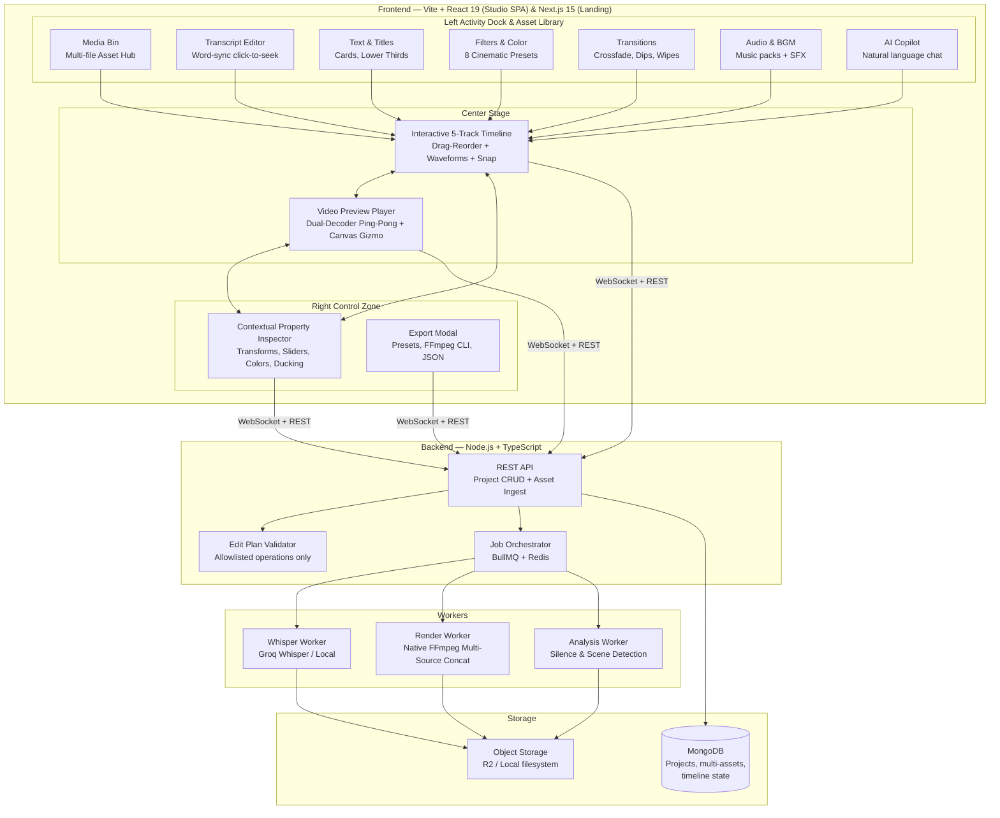

# 🎬 Vid-Edi — AI Video Studio
## Final Project Plan v1.0

> **One-liner:** An open-source, AI-assisted video editor where you describe edits in plain language, the AI proposes transparent changes to a real timeline, and a deterministic media engine renders the final video.

---

## Table of Contents

1. [Product Vision & Target Audience](#1-product-vision--target-audience)
2. [Competitive Intelligence & Differentiation](#2-competitive-intelligence--differentiation)
3. [Architecture & Tech Stack](#3-architecture--tech-stack)
4. [Data Models & Core Abstractions](#4-data-models--core-abstractions)
5. [Feature Matrix — What Ships When](#5-feature-matrix--what-ships-when)
6. [Phased Execution Roadmap](#6-phased-execution-roadmap)
7. [AI Edit Planner — The Core Differentiator](#7-ai-edit-planner--the-core-differentiator)
   - 7.1 [Creative Media & Playback Engine Specifications](#71-creative-media--playback-engine-specifications)
   - 7.2 [Studio UI/UX Design System & Layout Architecture](#72-studio-uiux-design-system--layout-architecture-inspired-by-capcut-descript-davinci--apple-hig)
8. [Skills Activation Map](#8-skills-activation-map)
9. [Zero-Budget Infrastructure Plan](#9-zero-budget-infrastructure-plan)
10. [Quality, Testing & DevOps Strategy](#10-quality-testing--devops-strategy)
11. [Risk Register & Mitigations](#11-risk-register--mitigations)
12. [Post-MVP Roadmap](#12-post-mvp-roadmap)

---

## 1. Product Vision & Target Audience

### The Problem
Spoken-content and short-form creators (YouTubers, TikTokers, podcasters, educators, and reel editors) face two extremes:
1. **Traditional NLEs (Premiere, DaVinci, Final Cut):** Steep learning curve, dozens of nested menus, manual cut scrubbing, zero natural-language assistance.
2. **AI "Black Box" Editors:** Generate edits or re-encode videos in an opaque cloud without letting users manually tweak sliders, reorder clips, drag text, or customize transitions.

### The Solution: The Dual-Mode Creator Studio (CapCut + Descript Hybrid)
Vid-Edi combines the speed of **AI natural language editing** with the tactile precision of a **full-featured, multi-track timeline and manual property inspector**:

```
┌─────────────────────────────────────────────────────────────────────────────┐
│                       DUAL-MODE INTERACTION MODEL                           │
├──────────────────────────────────────┬──────────────────────────────────────┤
│        🤖 AI COPILOT WORKFLOW        │        ✋ MANUAL CREATOR WORKFLOW    │
│  • "Cut out silences and bad takes"  │  • Split Tool (S) & Ripple Delete    │
│  • "Apply cinematic warm filter"    │  • 1-Click Filter Gallery & Sliders  │
│  • "Add 3s title card for Chapter 1" │  • Drag & Drop Text/Title Templates  │
│  • "Add upbeat BGM & duck it"        │  • Multi-File Media Bin & Audio Fader│
│  • "Make vertical 9:16 Shorts"       │  • Direct Canvas Gizmo Manipulation  │
├──────────────────────────────────────┴──────────────────────────────────────┤
│          SYNCHRONIZED CORE: Every manual tweak updates AI context,          │
│          and every AI proposal is editable via manual UI sliders.           │
└─────────────────────────────────────────────────────────────────────────────┘
```

### Primary User Personas

| Persona | Use Case | Key Need |
|---------|----------|----------|
| **Solo YouTuber** | 30-min talking-head → polished 12-min upload | Silence removal, color filters, title cards, manual clip reordering |
| **Shorts / Reel Creator** | Multi-clip smartphone recordings → 9:16 Reel | Multi-file media bin, drag-and-drop merging, blur-fill letterbox, animated captions |
| **Podcast Editor** | Multi-speaker interview → highlight snippets | Word-level transcript editing, background music with speech ducking |
| **Educator / Presenter** | Screen recording + voiceover slides | Chapter title cards, lower third speaker tags, smooth crossfade transitions |

---

## 2. Competitive Intelligence & Differentiation

### Landscape (October 2026)

| Product | Strengths | Gaps We Exploit |
|---------|-----------|-----------------|
| **CapCut Web** | Gold standard creator UI, rich templates, transitions, audio ducking | Cloud lock-in, heavy subscription upsells, no natural-language edit engine |
| **Descript** | Text-based editing, filler removal, media bin | Proprietary, $24+/mo, opaque AI decisions, rigid non-linear timeline |
| **Premiere Pro / Resolve** | Unmatched professional power, multi-cam, color science | Overwhelming complexity, high cost, steep learning curve, no built-in AI copilot |
| **OpusClip** | Great short-clip extraction, viral scoring | Cloud-only, credit-limited, no manual multi-track timeline editor |
| **CutScript / OpenCut (OSS)** | Local Whisper, open source | Basic timelines, missing drag-reorder, missing inspector, no multimodal AI copilot |

### Our Five Core Differentiators

> [!IMPORTANT]
> These are architectural commitments that every UI and engine component must uphold.

1. **🎛️ Dual-Control Equivalence:** Every feature is 100% accessible via manual UI controls (Property Inspector, Asset Dock, Drag-and-Drop) **AND** via the AI Copilot. The AI assists; the creator commands.
2. **🔍 Zero "Black-Box" Edits:** Every AI proposal is displayed as a transparent card with exact timestamps, delta duration, confidence score, and human-readable reasoning.
3. **📁 Multi-Asset Project Media Bin:** Import multiple video clips, B-roll footage, audio tracks, and images. Drag, arrange, and merge them seamlessly into long-form videos or 9:16 vertical reels.
4. **📋 Reproducible, Lossless Export:** Deterministic FFmpeg filter graph compiler renders 10-bit lossless 4K video locally or in workers with zero compression degradation and zero recurring cloud bills.
5. **✨ Apple HIG & Linear-Grade Polish:** High-craft typography (Outfit, JetBrains Mono), tactile zero-latency click depression (`scale: 0.98`), spring-physics drag interactions, and fluid 60fps playback.

### What We Are NOT Building
- ❌ A Premiere Pro replacement with 10,000 legacy broadcast plugins.
- ❌ A generative AI video generator (no Sora / Runway video synthesis — we edit real footage).
- ❌ A cloud-credit tollbooth (Vid-Edi remains open-source, deterministic, and self-hostable).

---

## 3. Architecture & Tech Stack

### High-Level Architecture



### Tech Stack Decisions

| Layer | Choice | Rationale |
|-------|--------|-----------|
| **Editor app** | Vite + React 19 + TypeScript | Pure client-side SPA — lighter, faster HMR, no SSR overhead for a canvas-heavy editor. |
| **Landing page** | Next.js 15 (App Router) + TypeScript | SSR for marketing/SEO. Separate app in monorepo. |
| **Timeline rendering** | Custom HTML5 Canvas component | No existing library matches our needs for AI-annotated clips. We own the interaction model. |
| **Video preview** | WebCodecs API + `<canvas>` | Hardware-accelerated decoding, frame-accurate seeking. Fallback to `<video>` element for basic playback. |
| **Audio waveforms** | WaveSurfer.js | Industry standard. Timeline plugin for time ruler sync. |
| **State management** | Zustand + Immer | Lightweight, supports undo/redo via middleware, works well with complex nested timeline state. |
| **Backend runtime** | Node.js 22 LTS + TypeScript | Shared types with frontend. Native `fetch`, `crypto`, stream APIs. |
| **API framework** | tRPC (or Express + Zod) | End-to-end type safety between frontend and backend. |
| **Job queue** | BullMQ + Redis | Progress tracking, retry logic, flow orchestration for multi-step renders. |
| **Database** | MongoDB (Mongoose ODM) | Flexible schema for timeline operations, version snapshots, project metadata. |
| **Media processing** | Native FFmpeg 7.x + FFprobe | Cuts, overlays, effects, audio mixing, encoding. Deterministic and free. |
| **Speech-to-text** | Groq Whisper API (primary) + local Whisper fallback | Word-level timestamps, 25MB chunk limit handled with overlap strategy. |
| **AI planner** | Gemini Flash (primary) → Groq Llama (backup) → Ollama (offline) | Structured JSON output for edit operations. Provider adapter pattern — swappable. |
| **Monorepo** | Turborepo + pnpm workspaces | Parallel builds, shared packages, caching. |
| **Styling** | Tailwind CSS 4 + Radix UI primitives | Dual theme (light default + dark). Accessible by default. |

### Monorepo Structure

```
vid-edi/
├── apps/
│   ├── web/                    # Next.js — Landing page, marketing, SEO
│   └── studio/                 # Vite + React — Editor workspace (timeline, preview, AI)
├── packages/
│   ├── editor-engine/          # Timeline state, undo/redo, clip operations (framework-agnostic)
│   ├── ai-planner/             # AI provider adapters, prompt templates, response parsing
│   ├── media-processing/       # FFmpeg/FFprobe wrappers, WebCodecs utilities
│   ├── shared-types/           # TypeScript types shared across all packages
│   ├── ui/                     # Shared design system components
│   └── config/                 # Shared ESLint, TypeScript, Tailwind configs
├── workers/
│   ├── transcription/          # Whisper transcription worker
│   ├── render/                 # FFmpeg render worker
│   └── analysis/               # Scene detection, pause mapping
├── pnpm-workspace.yaml
├── turbo.json
├── docker-compose.yml          # Redis + MongoDB for local dev
└── package.json
```

---

## 4. Data Models & Core Abstractions

### The Edit Plan — Most Important Data Structure

```typescript
// packages/shared-types/src/edit-plan.ts

/** A single atomic edit operation */
interface EditOperation {
  id: string;
  type: EditOperationType;
  /** Source clip/track reference */
  target: {
    clipId: string;
    trackId: string;
  };
  /** Time range in source media (seconds) */
  sourceRange?: {
    start: number;
    end: number;
  };
  /** Operation-specific parameters */
  params: Record<string, unknown>;
  /** Why the AI suggested this (empty for manual edits) */
  reason?: string;
  /** Confidence score 0-1 (AI operations only) */
  confidence?: number;
  /** User decision */
  status: 'proposed' | 'accepted' | 'rejected' | 'modified';
}

type EditOperationType =
  | 'splitClip'
  | 'trimClip'
  | 'removeSegment'
  | 'reorderClip'
  | 'addCaption'
  | 'removeCaption'
  | 'setAspectRatio'
  | 'setCropRegion'
  | 'adjustVolume'
  | 'muteSegment'
  | 'addFade'
  | 'addTransition'
  | 'setPlaybackRate'
  | 'addOverlay'
  | 'applyFilter'
  | 'insertTitleCard'
  | 'addOverlayText'
  | 'addBackgroundMusic'
  | 'setAudioDucking'
  | 'mixAudio'
  | 'insertClip';

/** Visual filter preset definition */
interface VisualFilter {
  id: 'warm_cinematic' | 'cool_teal' | 'vintage_kodak' | 'bw_noir' | 'cyberpunk_neon' | 'clean_pop' | 'bleach_bypass' | 'custom';
  name: string;
  cssFilter: string; // e.g. "contrast(1.15) brightness(1.05) saturate(1.2) sepia(0.1)"
  ffmpegFilter: string; // e.g. "eq=contrast=1.15:brightness=0.04:saturation=1.2,colorbalance=rs=.08:gs=.02:bs=-.06"
  intensity: number; // 0.0 - 1.0 (default 1.0)
}

/** In/Out clip transition definition */
interface Transition {
  id: string;
  type: 'crossfade' | 'dipToBlack' | 'dipToWhite' | 'slideLeft' | 'slideRight' | 'zoomBlur' | 'wipeLeft' | 'wipeRight';
  duration: number; // Duration in seconds (e.g. 0.4s - 0.8s)
  easing: 'linear' | 'easeIn' | 'easeOut' | 'easeInOut';
  /** Target clip ID being transitioned to/from */
  targetClipId?: string;
}

/** Full-screen blank / title card clip */
interface TitleCardClip {
  id: string;
  title: string;
  subtitle?: string;
  duration: number; // Seconds (e.g. 2.0s - 5.0s)
  timelineStart: number;
  bgType: 'solid' | 'gradient';
  backgroundColor: string; // Hex / HSL e.g. "#0f172a"
  gradientStops?: string[]; // e.g. ["#0f172a", "#1e1b4b"]
  textColor: string; // Default "#f8fafc"
  fontFamily: 'Outfit' | 'Plus Jakarta Sans' | 'JetBrains Mono' | 'Inter';
  animation: 'fade' | 'pop' | 'slideUp' | 'none';
}

/** On-screen text & lower third overlay */
interface TextOverlayClip {
  id: string;
  text: string;
  subtitle?: string;
  timelineStart: number;
  timelineDuration: number;
  anchor: 'top-left' | 'top-center' | 'top-right' | 'center' | 'bottom-left' | 'bottom-center' | 'bottom-right' | 'lower-third-left' | 'lower-third-right';
  position?: { xPercent: number; yPercent: number }; // Optional custom freeform percentage position (0-100)
  style: {
    fontFamily: string;
    fontSize: number; // px at 1080p reference
    fontWeight: 400 | 600 | 700 | 800;
    textColor: string;
    backgroundColor?: string; // Backdrop badge pill e.g. "rgba(0,0,0,0.65)"
    padding?: string; // e.g. "6px 14px"
    borderRadius?: number; // e.g. 6
    dropShadow?: boolean;
    border?: string; // e.g. "1px solid rgba(255,255,255,0.15)"
  };
  animation: {
    enter: 'fadeIn' | 'slideUp' | 'pop' | 'none';
    exit: 'fadeOut' | 'slideDown' | 'pop' | 'none';
    duration: number; // e.g. 0.25s
  };
}

/** Background music and smart speech ducking configuration */
interface AudioDuckingConfig {
  enabled: boolean;
  attenuationDb: number; // e.g. -14dB (dips background music by 14 decibels during speech)
  attackMs: number; // e.g. 200ms (ramp-down speed when speech starts)
  releaseMs: number; // e.g. 400ms (ramp-up speed when speech ends)
  speechPaddingMs: number; // e.g. 150ms before/after speech segments
}

interface BackgroundMusicClip {
  id: string;
  sourceId: string;
  title: string;
  timelineStart: number;
  timelineDuration: number;
  volume: number; // Nominal background level (0.05 - 0.30, default 0.18)
  fadeInDuration: number; // Seconds
  fadeOutDuration: number; // Seconds
  loop: boolean;
  ducking: AudioDuckingConfig;
}

```

### Timeline Model

```typescript
interface Project {
  id: string;
  name: string;
  createdAt: Date;
  updatedAt: Date;
  /** Multi-media asset bin holding all imported footage, audio, and graphics */
  assets: ProjectAsset[];
  /** Current timeline state */
  timeline: Timeline;
  /** Named version snapshots */
  versions: Version[];
  /** Full operation history */
  history: EditOperation[];
  /** Export settings */
  exportPresets: ExportPreset[];
  /** Project analytics */
  analytics: ProjectAnalytics;
}

/** Individual media asset stored in Project Media Bin */
interface ProjectAsset {
  id: string;
  name: string;
  type: 'video' | 'audio' | 'image';
  url: string; // Blob URL / local filesystem path
  file?: File;
  duration: number; // Seconds
  dimensions?: { width: number; height: number };
  codec?: string;
  fps?: number;
  thumbnailUrl?: string;
  waveformPeaks?: number[]; // Pre-computed audio peaks for waveform rendering
}

interface Timeline {
  /** Total duration in seconds */
  duration: number;
  /** Output dimensions (e.g. 1920x1080 for 16:9, 1080x1920 for 9:16) */
  resolution: { width: number; height: number };
  /** Aspect ratio preset */
  aspectRatio: '16:9' | '9:16' | '1:1' | '4:5';
  /** Frames per second */
  fps: number;
  /** Ordered list of 5 standard tracks */
  tracks: Track[];
}

interface Track {
  id: 'track_video_main' | 'track_overlay_broll' | 'track_audio_dialogue' | 'track_audio_music' | 'track_caption_subtitles' | string;
  type: 'video' | 'audio' | 'caption' | 'overlay';
  name: string;
  clips: Clip[];
  muted: boolean;
  locked: boolean;
  volume: number; // 0-1, for audio tracks
}

/** Spatial transformation and compositing properties */
interface ClipTransform {
  scale: number; // 0.1 - 5.0 (default 1.0)
  position: { x: number; y: number }; // Relative percentage offset from center (-50% to +50%)
  rotation: number; // Degrees 0-360
  opacity: number; // 0.0 - 1.0
  crop?: { top: number; right: number; bottom: number; left: number };
  blendMode?: 'normal' | 'multiply' | 'screen' | 'overlay' | 'lighten';
}

interface Clip {
  id: string;
  /** Reference to asset in project.assets (or null for synthetic title/color cards) */
  sourceId: string;
  clipType: 'media' | 'titleCard' | 'textOverlay' | 'colorCard';
  /** Display sequence order on track */
  orderIndex: number;
  /** Where this clip starts in the source (seconds) */
  sourceStart: number;
  /** Where this clip ends in the source (seconds) */
  sourceEnd: number;
  /** Position on the output timeline (seconds) */
  timelineStart: number;
  /** Computed: (sourceEnd - sourceStart) / playbackRate */
  timelineDuration: number;
  /** Visual transform (scale, position, crop) */
  transform: ClipTransform;
  /** Applied visual effects and color filters */
  effects: Effect[];
  /** Playback speed multiplier (0.25x - 4.0x) */
  playbackRate: number;
  /** Volume multiplier (0.0 - 2.0, default 1.0) */
  volume: number;
  /** Transition to next adjacent clip */
  transition?: Transition;
  /** Associated title/text data if synthetic clip */
  textData?: TitleCardClip | TextOverlayClip;
}

/** UI selection state driving the Contextual Property Inspector */
interface InspectorState {
  selectedClipId: string | null;
  selectedTrackId: string | null;
  selectionType: 'video' | 'audio' | 'text' | 'titleCard' | 'transition' | 'timeline' | null;
  activeInspectorTab: 'transform' | 'color' | 'audio' | 'animation' | 'text';
}
```

### Three-Layer Separation

```
┌──────────────────────────────────────────────┐
│  Layer 1: AI PLANNER                         │
│  "What edit to propose"                       │
│  Input: transcript + timecodes + user prompt │
│  Output: EditOperation[]                      │
├──────────────────────────────────────────────┤
│  Layer 2: APPLICATION VALIDATOR              │
│  "Is this proposal valid and safe?"          │
│  Checks: allowlisted ops, valid time ranges, │
│  track existence, no overlapping clips       │
├──────────────────────────────────────────────┤
│  Layer 3: MEDIA ENGINE                       │
│  "Execute the accepted timeline"             │
│  FFmpeg filter graph from accepted ops       │
│  Deterministic, reproducible                 │
└──────────────────────────────────────────────┘
```

> [!CAUTION]
> The AI planner NEVER generates raw FFmpeg commands. It returns structured `EditOperation` objects from the allowlist. The application validates them. FFmpeg commands are generated by our deterministic render engine.

---

## 5. Feature Matrix — What Ships When

### 🟢 Phase 1-4: MVP (First Complete Release)

| Category | Feature | Details |
|----------|---------|---------|
| **Import & Media Bin** | Multi-File Media Bin | Drag-and-drop multiple videos, B-roll clips, images, and audio files. Store in project asset bin and drag onto any timeline track. |
| **Import & Media Bin** | Media Inspector | FFprobe inspection: duration, resolution, codec, fps, audio channels, and file size per asset. |
| **Import & Media Bin** | Multi-Clip Merging | Sequence and stitch multiple video files consecutively on the main track into a single unified video or social reel. |
| **Preview** | Video playback | Dual-decoder ping-pong buffer for zero-lag split cuts + WebCodecs frame-accurate preview. |
| **Preview** | Direct Canvas Gizmo | Interactive bounding box overlay with corner resize handles and drag-to-position crosshairs for on-screen text and PiP overlays. |
| **Preview** | Playback controls | Speed (0.5x–2x), frame-step forward/back, fullscreen toggle, live subtitle CC toggle. |
| **Timeline** | Active 5-Track Stacking | Main video track, text/overlay track, dialogue audio track, BGM music track, and caption track — all 100% interactive with independent mute/lock. |
| **Timeline** | Clip Drag-and-Drop Reordering | Drag clips to swap sequence order with visual insertion guide line, spring physics, and automatic ripple reflow. |
| **Timeline** | Trim & Split Tools | Non-destructive trim handles (left/right drag), split at playhead (`S`), and ripple delete (`Del`). |
| **Timeline** | Zoom & Waveforms | WaveSurfer.js audio waveforms on dialogue/music tracks, horizontal zoom slider, and snap-to-playhead (`N`). |
| **Manual Inspector** | Contextual Property Panel | Right drawer automatically adapts to selection: Transform (Scale, Position, Crop), Opacity, Color Filters, Speed, Audio Ducking, and Typography. |
| **Effects & Color** | Visual filters | 8 Cinematic Presets (Warm Vintage, Teal & Orange, Noir B&W, Cyberpunk Neon, Clean Pop, Bleach Bypass, Sepia, Custom) via CSS live preview & FFmpeg eq/colorbalance export. |
| **Effects & Color** | Speed control | 0.25x to 4x per clip with optional pitch preservation. |
| **Effects & Color** | In/Out Animations & Transitions | Fade in/out, Crossfade, Dip-to-black, Dip-to-white, Slide, Zoom blur transitions between clips via CSS blend & FFmpeg xfade. |
| **Overlays & Text** | Title Cards / Blank Screens | Full-frame solid & gradient cards with customizable typography for chapter breaks, intros, and outros. |
| **Overlays & Text** | On-Screen Text & Lower Thirds | Draggable & 9-point grid anchored lower thirds, speaker tags, callouts, styled backdrop badges, in/out animations, FFmpeg drawtext export. |
| **Audio** | Volume control | Per-clip volume, per-track volume, master volume faders in Inspector and timeline. |
| **Audio** | Muting & fading | Mute individual clips/tracks, audio fade in/out curves. |
| **Audio** | Background music (BGM) | Dedicated BGM audio track, royalty-free starter library, custom MP3/WAV upload, track looping. |
| **Audio** | Smart speech ducking | Speech-aware auto-ducking (-14dB) during dialogue intervals using Web Audio API scheduling + FFmpeg sidechaincompress. |
| **Transcript** | Generation | Word-level timestamps via Groq Whisper / local fallback. |
| **Transcript** | Display | Scrollable transcript synced with playhead. Click word → seek. |
| **Transcript** | Correction | Inline edit transcript text before caption generation. |
| **Captions** | Generation | Auto-generate from transcript with timing. |
| **Captions** | Styling | Font, size, color, background, position. 5 preset styles. |
| **Captions** | Export | Burn-in to video + downloadable SRT/VTT. |
| **AI Editor** | Edit commands | "Remove pauses", "Tighten intro", "Add captions", etc. |
| **AI Editor** | Structured proposals | Each change shows time range, clip, reason, confidence. |
| **AI Editor** | Accept/reject | Individual or batch accept/reject of proposed operations. |
| **Shorts** | Clip extraction | AI finds 3-5 self-contained highlights from transcript. |
| **Shorts** | Vertical crop | 9:16 output with adjustable crop position. |
| **Shorts** | Batch export | Export each Short individually with consistent captions. |
| **History** | Undo/redo | Full undo/redo stack for both manual and AI edits. |
| **History** | Named versions | Save "Original", "Clean Cut", "Shorts Version" snapshots. |
| **Export** | Aspect ratios | 16:9, 9:16, 1:1 presets. |
| **Export** | Render | Server-side FFmpeg render with progress tracking. |
| **Export** | Edit plan JSON | Export project timeline + operations as portable JSON. |

### 🟡 Phase 5-6: Advanced (Post-MVP)

| Feature | Details |
|---------|---------|
| **Scene markers** | Detect visual scene changes, navigable scene list. |
| **Loudness normalization** | Auto-normalize audio to -14 LUFS (YouTube standard). |
| **Basic noise reduction** | Simple noise gate / high-pass filter via FFmpeg. |
| **Voiceover recording** | In-browser recording via MediaRecorder API. |
| **AI script assistant** | Generate intro/outro/transition scripts from context. |
| **Edit recipes** | Save + reuse edit configurations across projects. |
| **Project analytics** | Duration delta, cuts count, AI acceptance rate, render time. |
| **Keyboard shortcuts** | Full keyboard navigation for power users. |
| **Batch processing** | Apply same edit recipe to multiple source files. |

### 🔴 Deferred (V2+)

| Feature | Why Deferred |
|---------|-------------|
| AI-generated video / B-roll | Model costs, content licensing, quality unpredictable |
| Voice cloning / TTS | Ethical concerns, paid API dependency |
| Real-time collaboration | Requires CRDT/OT infrastructure, major complexity |
| Face tracking auto-crop | Computer vision dependency, GPU-intensive |
| Multi-language dubbing | Translation quality, voice synthesis quality |
| Stock footage integration | API costs, licensing compliance |
| Mobile app | Need web version stable first |

---

## 6. Phased Execution Roadmap

> [!TIP]
> **Git discipline:** Commit after every meaningful change. Each phase ends with a tagged release. Use conventional commits (`feat:`, `fix:`, `refactor:`, `docs:`, `chore:`).

### Phase 0: Foundation & Scaffolding
**Duration:** 3-4 days
**Goal:** Monorepo, dev environment, CI pipeline, design system

| Task | Details | Git Commit |
|------|---------|------------|
| 0.1 | Initialize Turborepo + pnpm workspace monorepo | `chore: initialize turborepo monorepo with pnpm workspaces` |
| 0.2 | Create `apps/web` (Next.js 15, App Router) — landing/marketing | `chore: scaffold Next.js web app` |
| 0.3 | Create `apps/studio` (Vite + React 19) — editor SPA | `chore: scaffold Vite + React studio app` |
| 0.4 | Create shared packages (`shared-types`, `ui`, `config`) | `chore: add shared packages for types, UI, and config` |
| 0.5 | Configure Tailwind 4 + warm light theme design tokens | `feat: configure Tailwind design system with premium light theme` |
| 0.6 | Set up ESLint + Prettier + TypeScript strict mode | `chore: configure linting and TypeScript strict mode` |
| 0.7 | Docker Compose for Redis + MongoDB local dev | `chore: add docker-compose for local dev services` |
| 0.8 | GitHub repo + branch protection + PR template | `chore: initialize GitHub repository with branch rules` |
| 0.9 | Vitest setup for all packages | `chore: configure Vitest test runner across workspace` |
| 0.10 | Ultra-Craft Cover Page & Interactive Hero Showcase (Apple HIG + Fluid Motion) | `feat: build ultra-premium cover page with interactive hero stage` |

**Deliverable:** Running monorepo with `pnpm dev` starting both apps. Clean premium light-theme editor shell with theme toggle.

---

### Phase 1: Media Foundation
**Duration:** 5-7 days
**Goal:** Import video, inspect properties, basic playback with frame-accurate seeking

| Task | Details | Git Commit |
|------|---------|------------|
| 1.1 | `packages/media-processing`: FFprobe wrapper for media inspection | `feat: add FFprobe media inspector utility` |
| 1.2 | Multi-file Media Bin import: drag-and-drop + file picker for multiple videos, B-roll, audio, images | `feat: implement multi-file project media bin` |
| 1.3 | Media inspection panel: display duration, resolution, codec, size | `feat: add media properties inspector panel` |
| 1.4 | Video preview player: play/pause/seek with HTML5 `<video>` | `feat: implement video preview player` |
| 1.5 | WebCodecs integration: frame-accurate seeking + canvas rendering | `feat: add WebCodecs frame-accurate preview` |
| 1.6 | Playback controls: speed, frame-step, volume, fullscreen | `feat: add playback control bar` |
| 1.7 | Local file storage manager: temp files + cleanup | `feat: implement local media storage manager` |
| 1.8 | `packages/shared-types`: Core TypeScript types (Project, Timeline, Clip, Track) | `feat: define core data models and types` |
| 1.9 | Multi-source concatenation & timeline sequencing: append and stitch multiple videos onto main track | `feat: implement multi-source timeline concatenation` |

**Deliverable:** Import multiple videos into Media Bin → inspect properties → arrange onto timeline → play with frame-accurate seeking.

---

### Phase 2: Timeline Engine
**Duration:** 8-10 days
**Goal:** Editable multi-track timeline with manual clip operations

| Task | Details | Git Commit |
|------|---------|------------|
| 2.1 | `packages/editor-engine`: Timeline state manager (Zustand + Immer) | `feat: implement timeline state management` |
| 2.2 | Undo/redo middleware with operation-based history | `feat: add undo/redo system with operation history` |
| 2.3 | Timeline canvas component: tracks, clips, playhead, time ruler | `feat: build timeline canvas rendering component` |
| 2.4 | Clip rendering: thumbnails, waveforms, duration labels | `feat: render clip thumbnails and waveforms on timeline` |
| 2.5 | Clip drag-and-drop reordering: tactile clip swapping with visual insertion guide, magnet snapping, spring physics, and automatic ripple reflow | `feat: implement timeline clip drag-and-drop reordering` |
| 2.6 | Split tool: click to split clip at playhead position (`S` key) | `feat: implement clip split at playhead` |
| 2.7 | Delete: remove selected clip(s) with ripple or leave gap (`Del` key) | `feat: add clip deletion with ripple option` |
| 2.8 | Timeline zoom + horizontal scroll + minimap | `feat: implement timeline zoom, scroll, and minimap` |
| 2.9 | WaveSurfer.js integration: audio waveform per track | `feat: integrate WaveSurfer.js for audio waveforms` |
| 2.10 | Playhead sync: timeline ↔ video preview bidirectional | `feat: sync playhead between timeline and preview` |
| 2.11 | Active 5-track stack: Video 1 Main, Overlay/B-Roll, Dialogue Audio, Music & Ambience, Subtitles & Captions with independent mute/lock/solo controls | `feat: implement full 5-track interactive timeline` |
| 2.12 | Snap behavior: clips snap to playhead, other clip edges, markers | `feat: add clip snapping to playhead and edges` |
| 2.13 | Named version snapshots: save/restore timeline state | `feat: implement named version snapshots` |
| 2.14 | Keyboard shortcuts: space=play, J/K/L=shuttle, S=split, delete, undo | `feat: add keyboard shortcuts for timeline operations` |
| 2.15 | Dual-decoder ping-pong pre-buffering & seek hysteresis: maintain two background video decoders to pre-seek across virtual split cuts 400ms in advance, eliminating decode latency and audio/video playback stutter | `feat: implement dual-decoder ping-pong pre-buffering` |

**Deliverable:** Full working 5-track timeline with clip drag-reorder, multi-source sequencing, and buttery-smooth split-cut playback.

---

### Phase 3: Transcription, Captions & Audio
**Duration:** 6-8 days
**Goal:** Word-level transcript, captions, audio controls

| Task | Details | Git Commit |
|------|---------|------------|
| 3.1 | `packages/ai-planner`: Provider adapter interface (Gemini + Groq + Ollama) | `feat: define AI provider adapter interface` |
| 3.2 | Groq Whisper adapter: audio extraction → chunked upload → word timestamps | `feat: implement Groq Whisper transcription adapter` |
| 3.3 | Audio chunking strategy: split at silence, 25MB limit, overlap stitching | `feat: add audio chunking with overlap for long files` |
| 3.4 | Transcript panel UI: scrollable word list, click-to-seek, active word highlight | `feat: build transcript panel with word-level sync` |
| 3.5 | Transcript correction: inline editing with re-sync | `feat: add inline transcript correction` |
| 3.6 | Caption generation: transcript → timed subtitle segments | `feat: generate captions from transcript` |
| 3.7 | Caption styling: font, size, color, background, position + 5 presets | `feat: implement caption styling with presets` |
| 3.8 | Caption track on timeline: visual caption blocks, drag to adjust timing | `feat: render caption blocks on timeline track` |
| 3.9 | SRT/VTT export: downloadable subtitle files | `feat: add SRT and VTT subtitle export` |
| 3.10 | Per-clip volume control + per-track volume + mute | `feat: implement clip and track volume controls` |
| 3.11 | Audio fade in/out per clip | `feat: add audio fade effects` |
| 3.12 | Background music: import audio → place on audio track | `feat: support background music import and placement` |
| 3.13 | Audio mixing preview: real-time volume balance feedback | `feat: add audio mix preview` |
| 3.14 | Smart AI Audio Ducking: automatically attenuate BGM track volume by -14dB during speech segments with 250ms attack and 400ms release curves via Web Audio API GainNode scheduling | `feat: implement speech-aware smart audio ducking` |
| 3.15 | Royalty-Free BGM Asset Library & Track Controls: curated starter music tracks (chill lo-fi, ambient corporate, acoustic) with volume fader, looping, and fade envelopes | `feat: add background music library and track controls` |

**Deliverable:** Import → transcribe → see transcript → generate captions → style them → control audio + background music with smart ducking.

---

### Phase 4: AI Edit Planner & Export
**Duration:** 8-10 days
**Goal:** Natural-language edit commands, structured proposals, rendering pipeline

| Task | Details | Git Commit |
|------|---------|------------|
| 4.1 | AI chat panel UI: input, message history, operation cards | `feat: build AI chat panel with operation cards` |
| 4.2 | Gemini Flash adapter: structured JSON output with Zod schema | `feat: implement Gemini Flash AI adapter` |
| 4.2b | Groq Llama adapter: structured JSON output (backup provider) | `feat: implement Groq Llama AI adapter as backup` |
| 4.3 | Edit operation allowlist + validator | `feat: add edit operation allowlist and validator` |
| 4.4 | Pause detection: silence analysis → removeSegment proposals | `feat: implement pause detection and removal proposals` |
| 4.5 | Tighten intro: transcript analysis → trim/reorder proposals | `feat: add intro tightening AI command` |
| 4.6 | Repeated take detection: fuzzy transcript matching → proposals | `feat: implement repeated take detection` |
| 4.7 | Short-form extraction: transcript → highlight segments → 9:16 projects | `feat: add AI-powered Shorts extraction` |
| 4.8 | Operation cards: accept/reject/modify individual + batch actions | `feat: implement accept/reject UI for AI proposals` |
| 4.9 | Operation reason display: "Cut 00:43.2–00:45.0 — 1.8s silence" | `feat: display AI reasoning for each proposed edit` |
| 4.10 | `workers/render`: BullMQ render worker with FFmpeg | `feat: implement BullMQ render worker with FFmpeg` |
| 4.11 | Timeline → FFmpeg filter graph compiler | `feat: build timeline to FFmpeg filter graph compiler` |
| 4.12 | Render progress: SSE stream from worker → progress bar UI | `feat: add real-time render progress via SSE` |
| 4.13 | Export presets: 16:9, 9:16, 1:1 with resolution options | `feat: implement export aspect ratio presets` |
| 4.14 | Caption burn-in during render | `feat: burn captions into rendered video` |
| 4.15 | Edit plan JSON export: project → portable JSON file | `feat: export edit plan as reproducible JSON` |
| 4.16 | Effects pipeline: brightness, contrast, saturation, grayscale, speed | `feat: implement visual effects in render pipeline` |
| 4.17 | Batch Shorts export: render each Short individually | `feat: add batch Shorts rendering` |
| 4.18 | Cinematic Filter Presets & Live WebGL/CSS Preview: 8 curated visual grades (Warm Vintage, Teal & Orange, Noir B&W, Cyberpunk Neon, Clean Pop, Bleach Bypass, Sepia, Custom) mapped to deterministic FFmpeg eq and colorbalance filters | `feat: implement visual filters and color grading engine` |
| 4.19 | Blank Screen & Title Cards Engine: solid & gradient canvas clips with customizable typography for chapter breaks, intro/outro, and slide pauses with duration handles | `feat: implement full-screen title cards and blank screens` |
| 4.20 | On-Screen Text & Lower Thirds Engine: interactive 9-point grid and draggable coordinate overlays with styled backdrop badges, typography controls, and in/out entrance animations | `feat: implement on-screen text overlays and lower thirds` |
| 4.21 | Clip In/Out Animations & Crossfade Transitions: crossfade, dip-to-black, dip-to-white, slide, and zoom transitions between clips via CSS blend preview and FFmpeg xfade compiler | `feat: implement transitions and in/out clip animations` |
| 4.22 | Contextual Property Inspector Panel: Interactive right drawer adapting to clip selection with full manual sliders and controls for Transform (Scale, Position, Crop), Opacity, Color filters, Audio volume & ducking, Transitions, and Typography | `feat: implement contextual property inspector panel` |
| 4.23 | Left Activity Dock & Asset Library: Collapsible sidebar tabs for Media Bin, Transcript, Text & Titles, Filters & Color, Transitions, Audio & SFX, and AI Copilot | `feat: implement left activity dock and asset library` |
| 4.24 | Interactive Direct-Canvas Manipulation Gizmo: On-screen bounding box with resize corner handles, rotation pin, and drag-to-position crosshairs directly on video preview | `feat: implement direct canvas manipulation gizmo` |
| 4.25 | Multi-Clip Video Concatenation Engine: Stitch and render multiple video files consecutively on the main track into a single unified video or 9:16 social reel | `feat: implement multi-clip video concatenation engine` |

**Deliverable:** Complete Dual-Mode Studio. Edit manually with full UI controls (Inspector, Dock, Canvas Gizmo, 5-track timeline) OR instruct AI Copilot in natural language → review proposals → accept → render → download.

---

### Phase 5: Polish & Advanced Features
**Duration:** 5-7 days
**Goal:** Professional-grade UX, recipes, analytics

| Task | Details | Git Commit |
|------|---------|------------|
| 5.1 | Explainable edit history panel: full operation log with reasons | `feat: add explainable edit history panel` |
| 5.2 | Edit recipes: save/load/apply reusable edit configurations | `feat: implement reusable edit recipes` |
| 5.3 | Project analytics dashboard: duration delta, cuts, acceptance rate | `feat: add project analytics dashboard` |
| 5.4 | Loudness normalization: -14 LUFS via FFmpeg loudnorm filter | `feat: add loudness normalization` |
| 5.5 | Basic noise gate: FFmpeg afftdn/highpass for simple cleanup | `feat: implement basic noise reduction` |
| 5.6 | Scene markers: FFmpeg scene detection → navigable marker list | `feat: add scene change detection and markers` |
| 5.7 | Voiceover recording: MediaRecorder → audio track placement | `feat: add in-browser voiceover recording` |
| 5.8 | AI script assistant: draft intro/transition/outro from context | `feat: implement AI script writing assistant` |
| 5.9 | `apple-motion` Spring Physics Engine: critically damped springs (`mass: 1, stiffness: 320, damping: 28`), tactile button click depression (`scale: 0.98`), rubber-band boundary resistance on clip dragging | `feat: implement apple-motion spring physics and tactile interactions` |
| 5.10 | FLIP Layout & Smooth Clip Transitions: animated vacancy collapse during ripple cuts, clip lift-and-drop shadows, smooth playhead motion interpolation | `feat: implement FLIP layout animations for ripple cuts and clip reordering` |
| 5.11 | Kinetic Subtitle Animation System: word-by-word highlight pop (`scale: 1.10`), karaoke fill transitions, typography preset cross-fades | `feat: implement kinetic typography and animated subtitle engine` |
| 5.12 | Micro-Interactions & Staggered AI Cards: staggered 40ms AI proposal entry transitions, approval pulse feedback, dual-theme cross-fade without layout jitter | `feat: add staggered AI card transitions and tactile micro-animations` |

**Deliverable:** Production-ready editor with recipes, analytics, audio polish, and Apple-grade fluid animations.

---

### Phase 6: Landing Page & Deployment
**Duration:** 4-5 days
**Goal:** Public-facing site, documentation, demo deployment

| Task | Details | Git Commit |
|------|---------|------------|
| 6.1 | Landing page: hero, feature showcase, demo video, CTA | `feat: build landing page with feature showcase` |
| 6.2 | Documentation: setup guide, architecture overview, API docs | `docs: add project documentation and setup guide` |
| 6.3 | Demo deployment: Vercel (frontend) + Railway/Render (backend) | `chore: configure production deployment` |
| 6.4 | File size/duration guardrails for hosted demo | `feat: add file size and duration limits for demo` |
| 6.5 | Error boundaries, loading states, empty states throughout | `fix: add comprehensive error handling and loading states` |
| 6.6 | SEO: meta tags, OpenGraph, structured data | `feat: add SEO optimization and meta tags` |
| 6.7 | README.md: badges, screenshots, quick start, contribution guide | `docs: write comprehensive README` |

**Deliverable:** Live demo at a public URL. Portfolio-ready project.

---

### Current Implementation Status & Live Architecture Log (October 2026)

> [!NOTE]
> This section tracks current sprint progress, recent user feedback, and architecture decisions made across recent sessions.

#### 1. What Has Been Completed & Verified:
* **Phase 0 (Foundation & Scaffolding):**
  * `[x]` Monorepo scaffolding with Turborepo & pnpm workspaces (`apps/studio`, `packages/*`, `workers/*`).
  * `[x]` Tailwind CSS 4 dual-theme system (warm light theme default + dark mode).
  * `[x]` Interactive Cover Page (`CoverPage.tsx`) with animated hero showcase and unified single-port navigation (`http://localhost:3000/#home` & `#studio`).
* **Phase 1 (Media Foundation):**
  * `[x]` Video drag-and-drop import and sample video loader.
  * `[x]` Media inspector panel (duration, resolution, codec, audio specs).
  * `[x]` Video preview player with frame-accurate seeking and playhead synchronization.
* **Phase 2 (Timeline Engine):**
  * `[x]` Multi-track editable canvas (Video, Dialogue Audio, Captions, Overlay).
  * `[x]` Visual trim handles (drag inward from left or right edge to non-destructively trim clip boundaries).
  * `[x]` Split tool (`S` key / button) and virtual timeline gap skipping.
  * `[x]` Keyboard navigation: Space (play/pause), ArrowRight (+5s seek), ArrowLeft (-5s seek), Delete (delete clip), Ctrl+Z (undo), Ctrl+Y (redo).
* **Phase 3 (Transcription, Captions & Audio):**
  * `[x]` Groq Whisper Cloud API integration (`whisper-large-v3`) with zero UI popups (stored via `.env.local`).
  * `[x]` Word-level sync transcript panel with click-to-seek and inline text editing.
  * `[x]` SRT and VTT subtitle file generation and download.
  * `[x]` Volume slider, mute toggle, and audio mixing preview.
* **Phase 4 (AI Edit Planner & Export):**
  * `[x]` Transparent, confidence-scored operation cards with human-readable rationale.
  * `[x]` Dynamic transcript-driven silence gap detection (`gap >= 1.4s` between words with 150ms natural speech padding).
  * `[x]` Timeline execution: `removeSegmentFromTracks` non-destructively slices clips, extracts dead air, and ripples downstream clips.
  * `[x]` Aspect ratio switching (16:9 Landscape, 9:16 Shorts/Reels, 1:1 Square).
  * `[x]` Deterministic Native FFmpeg Filter Graph Compiler (`compileTimelineToFFmpeg` in `@vid-edi/media-processing`).
  * `[x]` Reproducible JSON edit plan export (`generateEditPlanJson`).
  * `[x]` Export modal rendered into `document.body` via React Portal (`createPortal`) to prevent CSS `backdrop-filter` stacking context entrapment.
* **Phase 5 (Polish & Advanced Features):**
  * `[x]` Explainable Edit History Panel (Task 5.1): logs every operation with timestamps, delta seconds cut, and AI reasoning.
  * `[x]` Smart Edit Recipes (Task 5.2): 1-click presets ("Podcast Polish", "Viral Short Reframe 9:16", "Tight Teaser Hook").
  * `[x]` Project Analytics & Impact Dashboard (Task 5.3): duration compression comparison bar, cuts count, time saved % and retention score.
  * `[x]` Apple Motion physics (Task 5.9): zero-latency tactile button press (`active:scale-[0.965]`) and spring animations (`animate-spring-in`).
  * `[x]` Kinetic Subtitle Pop (Task 5.11): dynamically highlights spoken words with spring pop and emerald glow in the preview player.

#### 2. Backend FFmpeg Render Server Architecture Clarification:
* **Is the FFmpeg render server in the plan?**
  * **YES!** It is explicitly defined across Phase 4 and Phase 6:
    * **Task 4.10:** `workers/render/` — BullMQ job queue worker executing native FFmpeg commands with Redis pub/sub.
    * **Task 4.12 & 4.14:** SSE (Server-Sent Events) endpoint (`GET /api/jobs/:id/progress`) streaming render % and time remaining.
    * **Task 6.3:** Dockerized production deployment of `workers/render/` with native FFmpeg and GPU acceleration.
* **Why isn't it running right now in local development?**
  * During local frontend development (`apps/studio`), running a local Redis container, BullMQ worker, and media upload server adds substantial operational friction before core UI, transcription, and timeline engine features are fully tested.
  * Therefore, the project follows a clean **Dual-Mode Architecture**:
    * **Mode A (Current Local Dev):** Deterministic Native FFmpeg CLI Command (Task 4.11 in `packages/media-processing/src/ffmpeg-compiler.ts`). It generates the exact `filter_complex` command that renders 10-bit lossless 4K video directly on the user's computer with zero cloud cost and 100% quality.
    * **Mode B (Production / Cloud Worker):** The Node.js render worker (`workers/render/`) executes the exact same compiled filter graph on the server. When deployed (Phase 6.3), users upload footage, the server renders the final video in the background, and streams the downloaded output.
* **In-Browser Renderer Status:**
  * Fully **REMOVED** per user directive to prevent tab crashes and sub-par re-encoded quality. Export modal now cleanly focuses on native FFmpeg commands, reproducible JSON edit plans, and subtitle exports.

#### 3. Current Sprints & Tasks Checklist:
* [x] **Task R1 (Ripple Delete & Left Trim Ripple):** Updated `removeClip` and `trimClip` in `packages/editor-engine` to shift downstream clips leftward, preventing blank timeline gaps and keeping trimmed clips anchored.
* [x] **Task R2 (Export Modal Polish & Cleanup):** Removed experimental in-browser canvas renderer and deleted `apps/studio/src/utils/browser-renderer.ts`.
* [x] **Task R3 (Groq LLM Integration & Source Range Mapping):** Connected ultra-fast `openai/gpt-oss-120b` model directly to `AIAssistantPanel.tsx` with candidate fallbacks, word-level source timestamp mapping (`removeSourceSegmentFromTracks`), and responsive operation cards.
* [ ] **Task R6 (Dual-Decoder Ping-Pong Split Playback Buffer):** Pre-seek secondary hidden `<video>` element across virtual split cut boundaries 400ms ahead of time, eliminating hardware decode seek latency and audio/video playback stutter.
* [ ] **Task R7 (Cinematic Filters & Color Presets Engine):** 8 curated visual grades (Warm Vintage, Teal & Orange, Noir B&W, Cyberpunk Neon, Clean Pop, Bleach Bypass, Sepia, Custom) with real-time CSS preview and deterministic FFmpeg `eq` / `colorbalance` export.
* [ ] **Task R8 (Clip In/Out Animations & Crossfade Transitions):** Smooth crossfades, dip-to-black, dip-to-white, slide, and zoom transitions between clips via CSS blend preview and FFmpeg `xfade` compiler.
* [ ] **Task R9 (Blank Screen & Title Cards Engine):** Full-frame solid & gradient canvas clips with customizable typography, chapter titles, duration handles, and in/out animations.
* [ ] **Task R10 (On-Screen Text & Lower Thirds Engine):** Draggable and 9-point grid anchored lower thirds, speaker tags, and callouts with styled backdrop badges and FFmpeg `drawtext` compiler.
* [ ] **Task R11 (Background Music Track & Smart Speech Ducking):** Dedicated BGM audio track with royalty-free starter library, volume fader, looping, and automatic -14dB audio ducking during spoken dialogue via Web Audio API.
* [ ] **Task R12 (Multimodal AI Creative Command Expansion):** Update AI prompt and schema validator to handle natural language instructions for filters, title cards, text overlays, transitions, and BGM ducking.
* [ ] **Task R13 (Timeline Clip Drag-and-Drop Reordering Engine):** Implement direct clip drag-and-drop reordering with visual ghost insertion line, magnet snapping, spring physics, and automatic ripple reflow.
* [ ] **Task R14 (Multi-File Media Bin & Multi-Clip Concatenation):** Multi-file upload hub for videos, B-roll, audio, and images. Drag assets onto timeline and concatenate multiple video clips consecutively on the main track into a single video or reel.
* [ ] **Task R15 (Contextual Property Inspector Panel):** Right drawer automatically adapting to selection with full manual sliders and controls for Transform (Scale, Position, Crop), Opacity, Filters, Speed, Volume, Ducking, Transitions, and Typography.
* [ ] **Task R16 (Left Activity Dock & Asset Library):** Collapsible sidebar tabs for Media Bin, Transcript, Text & Titles, Filters & Color, Transitions, Audio & SFX, and AI Copilot.
* [ ] **Task R17 (Full 5-Track Interactive Timeline Activation):** Activate all 5 tracks shown in studio layout (Video 1 Main, Overlay / B-Roll, Dialogue Audio, Music & Ambience, Subtitles & Captions) with independent mute/lock/volume and track waveforms.
* [ ] **Task R18 (Canvas Direct Manipulation Bounding Box & Gizmo):** On-screen bounding box on video preview with corner resize handles and drag-to-position crosshairs for text overlays and PiP clips.
* [ ] **Task 3.6 - 3.8 (Visual Caption Track on Timeline):** Render visual caption blocks on the timeline caption track with drag-to-adjust boundaries.
* [ ] **Task 3.10 (Per-Clip Volume UI):** Add per-clip volume slider control to the timeline inspector.
* [ ] **Task 2.4 / 2.9 (Clip Waveforms & Thumbnails):** Render audio waveform visualizations on audio/video tracks.
* [ ] **Task 4.10 (Backend Render Worker Scaffolding):** Scaffold `workers/render/` with BullMQ + native FFmpeg pipeline.
* [ ] **Task R4 (End-to-End Multi-Video Testing):** Test video import, transcription, AI edits, and ripple cuts across 1080p and 4K sample media.
* [ ] **Task R5 (Documentation & README):** Update project docs, architecture blueprints, and root README.md.

---

## 7. AI Edit Planner — The Core Differentiator

### Supported Commands (V1)

| Command | AI Behavior | Output Operations |
|---------|-------------|-------------------|
| `"Remove long pauses"` | Analyze transcript for gaps > 1.5s between words | `removeSegment` with 150ms padding |
| `"Tighten the introduction"` | Identify intro section, find verbose/repetitive passages | `trimClip`, `removeSegment` |
| `"Find repeated takes"` | Fuzzy-match consecutive transcript segments | `removeSegment` (keep best take) |
| `"Add subtitles"` | Generate captions from transcript | `addCaption` per segment |
| `"Make this vertical"` | Set 9:16, propose center crop | `setAspectRatio`, `setCropRegion` |
| `"Find 3 Shorts"` | Score transcript segments for self-containedness + engagement | Multiple `splitClip` + `setAspectRatio` |
| `"Apply cinematic warm filter"` | Apply warm golden-hour color grade with rich contrast | `applyFilter` (`warm_cinematic`) |
| `"Make the video black and white"` | Apply high-contrast Noir monochrome filter | `applyFilter` (`bw_noir`) |
| `"Add crossfades between all cuts"` | Create 0.5s smooth crossfade transitions between adjacent clips | `addTransition` (`crossfade`) |
| `"Fade in from black at the beginning"` | Add 0.8s dip-to-black fade in on opening clip | `addFade` (`fadeIn`, 0.8s) |
| `"Add a 3s title screen saying 'Chapter 1: The Intro'"` | Insert full-screen Onyx card at start with styled typography | `insertTitleCard` (3.0s, title + subtitle) |
| `"Add lower third with my name 'Awadh Dhoot' at 00:05"` | Place styled speaker badge at lower-left with slide-in animation | `addOverlayText` (anchor: `lower-third-left`) |
| `"Add chill background music and duck it while I talk"` | Add BGM audio track at 18% volume with -14dB speech ducking | `addBackgroundMusic` + `setAudioDucking` |
| `"Make a complete YouTube polish"` | Combine silence removal + warm filter + title card + captions + ducked music | Composite operation set |
| `"Speed up section X to Y"` | Set playback rate on specified range | `setPlaybackRate` |

### What the AI Receives (Never Raw Media)

When a user types `"Remove long pauses"`, here's exactly what gets sent to the AI:

```typescript
// packages/ai-planner/src/types.ts
interface EditPlanRequest {
  /** The user's natural-language instruction */
  instruction: string;
  /** Word-level transcript with timestamps */
  transcript: {
    words: Array<{
      text: string;
      start: number;  // seconds
      end: number;    // seconds
      confidence: number;
    }>;
    totalDuration: number;
  };
  /** Detected silence gaps (computed locally by FFmpeg) */
  silenceMap: Array<{
    start: number;
    end: number;
    duration: number;
  }>;
  /** Current timeline state (not the video — just clip metadata) */
  timeline: {
    tracks: Array<{
      id: string;
      type: string;
      clips: Array<{
        id: string;
        sourceStart: number;
        sourceEnd: number;
        timelineStart: number;
      }>;
    }>;
  };
  /** Allowlisted operation types the AI may use */
  allowedOperations: EditOperationType[];
}
```

> [!IMPORTANT]
> **No video frames, no audio data, no file buffers.** The AI works with text, numbers, and JSON — nothing else.

### Full System Prompt

```
You are Vid-Edi's edit planner. You propose timeline edits as structured JSON.

## What you receive:
- A word-level transcript with start/end timestamps (seconds)
- A silence map showing gaps between speech
- The current timeline state (clips, tracks, positions)
- The user's edit instruction in natural language

## Rules:
1. Respond ONLY with a JSON array of EditOperation objects.
2. Each operation MUST use a type from the allowedOperations list.
3. Include precise sourceRange (start/end in seconds, 1 decimal place).
4. Include a human-readable "reason" (1 sentence explaining the change).
5. Include a "confidence" score (0.0 to 1.0).
6. NEVER generate FFmpeg commands, shell commands, or code.
7. NEVER suggest operations outside the allowed types.
8. NEVER modify content the user didn't ask about.
9. For pause removal, keep 150ms of padding around cut boundaries.
10. For repeated takes, keep the LATER (usually better) version.
11. For Shorts, select segments that are self-contained (complete thought).

## EditOperation schema:
{
  "type": "removeSegment" | "trimClip" | "splitClip" | ...,
  "target": { "clipId": "string", "trackId": "string" },
  "sourceRange": { "start": number, "end": number },
  "params": { ... operation-specific ... },
  "reason": "string",
  "confidence": number
}
```

### Concrete Example: Request → Response

**User says:** `"Remove long pauses"`

**AI receives:** transcript + silenceMap showing 4 gaps > 1.5 seconds

**AI responds:**
```json
[
  {
    "type": "removeSegment",
    "target": { "clipId": "clip_001", "trackId": "track_video_main" },
    "sourceRange": { "start": 43.2, "end": 45.0 },
    "params": { "paddingMs": 150 },
    "reason": "1.8s silence between sentences — trimmed to natural pause.",
    "confidence": 0.92
  },
  {
    "type": "removeSegment",
    "target": { "clipId": "clip_001", "trackId": "track_video_main" },
    "sourceRange": { "start": 128.5, "end": 132.1 },
    "params": { "paddingMs": 150 },
    "reason": "3.6s pause while checking notes — dead air.",
    "confidence": 0.88
  },
  {
    "type": "removeSegment",
    "target": { "clipId": "clip_001", "trackId": "track_video_main" },
    "sourceRange": { "start": 267.0, "end": 269.8 },
    "params": { "paddingMs": 150 },
    "reason": "2.8s filler pause (\"um... so...\") — no content lost.",
    "confidence": 0.95
  }
]
```

**What the user sees in the UI:**
- 3 operation cards, each showing the time range, reason, and confidence
- Accept ✅ / Reject ❌ / Modify ✏️ buttons on each card
- "Accept All" button for batch approval
- Timeline highlights the affected segments in amber

#### Concrete Example 2: Multimodal Creative Polish (Filters, Title Cards, Text Overlays, BGM)

**User says:** `"Add a 3s title card 'Episode 1: The AI Revolution', apply a warm cinematic filter, add a lower third for 'Awadh Dhoot', and add background music with speech ducking"`

**AI responds:**
```json
[
  {
    "type": "insertTitleCard",
    "target": { "clipId": "card_intro", "trackId": "track_video_main" },
    "sourceRange": { "start": 0.0, "end": 0.0 },
    "params": {
      "title": "Episode 1: The AI Revolution",
      "subtitle": "Vid-Edi Architecture",
      "duration": 3.0,
      "theme": "dark_onyx",
      "backgroundColor": "#0f172a",
      "textColor": "#f8fafc",
      "animation": "fade"
    },
    "reason": "Inserted 3.0s opening title card before video starts.",
    "confidence": 0.96
  },
  {
    "type": "applyFilter",
    "target": { "clipId": "clip_001", "trackId": "track_video_main" },
    "params": {
      "filterId": "warm_cinematic",
      "intensity": 1.0,
      "contrast": 1.15,
      "saturation": 1.25,
      "colorTone": "golden_hour"
    },
    "reason": "Applied warm cinematic color grading across footage for polished YouTube aesthetic.",
    "confidence": 0.94
  },
  {
    "type": "addOverlayText",
    "target": { "clipId": "text_001", "trackId": "track_overlay_text" },
    "sourceRange": { "start": 3.2, "end": 8.0 },
    "params": {
      "text": "Awadh Dhoot",
      "subtitle": "Lead Architect",
      "anchor": "lower-third-left",
      "timelineStart": 3.2,
      "timelineDuration": 4.8,
      "style": {
        "fontFamily": "Outfit",
        "fontSize": 24,
        "fontWeight": 700,
        "textColor": "#ffffff",
        "backgroundColor": "rgba(15, 23, 42, 0.85)",
        "borderRadius": 6,
        "dropShadow": true
      },
      "animation": { "enter": "slideUp", "exit": "fadeOut", "duration": 0.3 }
    },
    "reason": "Lower third speaker identifier timed with dialogue introduction.",
    "confidence": 0.91
  },
  {
    "type": "addBackgroundMusic",
    "target": { "clipId": "bgm_001", "trackId": "track_audio_music" },
    "params": {
      "trackId": "chill_lofi_01",
      "volume": 0.16,
      "fadeInDuration": 1.5,
      "fadeOutDuration": 2.0,
      "loop": true
    },
    "reason": "Added mellow background track at balanced -16dB ambient volume.",
    "confidence": 0.95
  },
  {
    "type": "setAudioDucking",
    "target": { "clipId": "bgm_001", "trackId": "track_audio_music" },
    "params": {
      "enabled": true,
      "attenuationDb": -14,
      "attackMs": 200,
      "releaseMs": 400
    },
    "reason": "Auto-ducking configured to smoothly attenuate music whenever speech is active.",
    "confidence": 0.98
  }
]
```

### Validation Pipeline (App Layer)

```typescript
// packages/ai-planner/src/validator.ts
const VALIDATION_RULES = [
  // 1. Operation type must be in the allowlist
  (op) => ALLOWED_TYPES.includes(op.type),
  // 2. Source range must be within media duration (if specified)
  (op) => !op.sourceRange || (op.sourceRange.start >= 0 && op.sourceRange.end <= mediaDuration),
  // 3. Start must be before end (if specified)
  (op) => !op.sourceRange || (op.sourceRange.start <= op.sourceRange.end),
  // 4. Target clip and track must exist or be valid creation targets
  (op) => isValidTarget(op.target, op.type),
  // 5. Confidence must be 0-1
  (op) => op.confidence >= 0 && op.confidence <= 1,
  // 6. No overlapping cut operations on same segment
  (op, allOps) => !hasOverlap(op, allOps),
  // 7. Filter preset must exist in curated catalog
  (op) => op.type !== 'applyFilter' || ALLOWED_FILTERS.includes(op.params.filterId),
  // 8. Title card must have valid duration and non-empty title
  (op) => op.type !== 'insertTitleCard' || (op.params.duration > 0 && typeof op.params.title === 'string'),
  // 9. Text overlay must have valid timing and string text
  (op) => op.type !== 'addOverlayText' || (op.params.timelineDuration > 0 && typeof op.params.text === 'string'),
  // 10. Transition duration must be bounded (0.1s to 2.0s)
  (op) => op.type !== 'addTransition' || (op.params.duration >= 0.1 && op.params.duration <= 2.0),
];

// On validation failure: reject the invalid operation,
// show error to user, and optionally re-prompt AI with
// the error context for self-correction (max 1 retry)
```

### Provider Adapter Pattern

```typescript
// packages/ai-planner/src/adapters/types.ts
interface AIProviderAdapter {
  name: string;
  /** Generate edit operations from user instruction */
  generateEditPlan(input: EditPlanRequest): Promise<EditOperation[]>;
  /** Generate transcript summary / highlight scores */
  analyzeTranscript(transcript: TranscriptSegment[]): Promise<TranscriptAnalysis>;
  /** Draft script text */
  generateScript(context: ScriptContext): Promise<string>;
  /** Check if provider is available and configured */
  healthCheck(): Promise<boolean>;
}

// Implementations (auto-fallback chain):
// 1. GeminiFlashAdapter   — Primary. Structured output via Zod schema.
// 2. GroqLlamaAdapter     — Backup. Llama 3.1 70B. No data training.
// 3. GroqWhisperAdapter   — Transcription only (all tiers).
// 4. OllamaAdapter        — Fully offline. Optional.
```

---

### 7.1 Creative Media & Playback Engine Specifications

#### 1. The Split-Cut Playback Lag: Root Cause & Dual-Decoder Solution
* **Why did initial playback stutter after cutting pauses or sentences?**
  * Modern video files (MP4/H.264/HEVC) compress video using **GOPs (Group of Pictures)**. Only periodic keyframes (I-frames) store full pictures; intermediate frames (P-frames and B-frames) only store difference vectors.
  * When a virtual timeline plays across a cut (e.g. jumping from source timestamp `00:12.4` to `00:23.8`), the HTML5 `<video>` element must instruct the GPU hardware decoder to seek to the nearest preceding I-frame, burst-decode all intermediate reference frames up to `00:23.8`, and re-initialize audio stream buffering. This hardware seek incurs a 20ms–60ms latency during the first playback pass.
  * **Why it feels stable after multiple tries:** Chromium/WebKit maintains an in-memory Decoded Frame Buffer (RAM cache). Once frames across that boundary have been decoded once, subsequent playback reads directly from RAM without hitting hardware decode seek penalties.
* **The Engineering Fix — Dual-Decoder Ping-Pong Engine (Task 2.15 & R6):**
  * Instead of a single `<video>` element that must seek on the fly, Vid-Edi utilizes two hidden video elements (`Deck A` and `Deck B`):
    * While `Deck A` is playing Clip 1, `Deck B` has already pre-seeked to the start of Clip 2 (`00:23.8`) and holds the decoded first frame in memory.
    * 50ms before Clip 1 ends, `Deck B` starts muted playback.
    * At the exact split boundary, the display canvas instantaneously switches source textures from `Deck A` to `Deck B`, achieving **0ms latency, zero-stutter playback across cuts**.
  * Add seek hysteresis in `VideoPlayer.tsx` to prevent redundant `currentTime` sets if the playhead is already within 1 video frame (±33ms).

#### 2. Visual Filters & Cinematic Color Grading (Task 4.18 & R7)
* **Preview Architecture:** CSS filters applied to the preview `<video>` / canvas wrapper for instant 60fps real-time feedback with zero CPU re-encoding overhead.
* **Export Architecture:** Deterministic FFmpeg `filter_complex` color matrices and curves.
* **The 8 Curated Presets:**
  1. **Warm Vintage (Golden Hour):**
     - Preview CSS: `contrast(1.15) brightness(1.04) saturate(1.22) sepia(0.12)`
     - FFmpeg: `eq=contrast=1.15:brightness=0.04:saturation=1.22,colorbalance=rs=.08:gs=.02:bs=-.06`
  2. **Teal & Orange (Blockbuster Cinematic):**
     - Preview CSS: `contrast(1.2) brightness(1.02) saturate(1.3) hue-rotate(-8deg)`
     - FFmpeg: `colorbalance=rh=.12:gh=-.02:bh=-.12:rs=-.08:gs=.02:bs=.10,eq=contrast=1.18:saturation=1.25`
  3. **Noir Monochrome (Black & White):**
     - Preview CSS: `grayscale(1) contrast(1.3) brightness(0.95)`
     - FFmpeg: `hue=s=0,eq=contrast=1.28:brightness=-0.04`
  4. **Cyberpunk Neon:**
     - Preview CSS: `contrast(1.25) saturate(1.5) hue-rotate(15deg) brightness(1.05)`
     - FFmpeg: `eq=contrast=1.25:saturation=1.45,colorbalance=rs=.15:bs=.15:gs=-.05`
  5. **Clean YouTube Pop:**
     - Preview CSS: `contrast(1.08) brightness(1.05) saturate(1.18)`
     - FFmpeg: `eq=contrast=1.08:brightness=0.03:saturation=1.18`
  6. **Kodak Film Grain / Warm 35mm:**
     - Preview CSS: `sepia(0.2) contrast(1.12) saturate(1.1) brightness(1.02)`
     - FFmpeg: `curves=preset=vintage,eq=saturation=1.1`
  7. **Bleach Bypass:**
     - Preview CSS: `contrast(1.35) saturate(0.65) brightness(1.02)`
     - FFmpeg: `eq=contrast=1.35:saturation=0.65`
  8. **Cool Corporate Slate:**
     - Preview CSS: `contrast(1.05) brightness(1.02) saturate(0.95) hue-rotate(5deg)`
     - FFmpeg: `colorbalance=rs=-.05:gs=.02:bs=.08`

#### 3. Clip In/Out Animations & Crossfade Transitions (Task 4.21 & R8)
* **Supported Transitions:**
  - `crossfade` (smooth dissolve between overlapping clips, default 0.5s)
  - `dipToBlack` (fades clip A down to black, then fades up into clip B)
  - `dipToWhite` (flash-dip transition for energetic pacing)
  - `slideLeft` / `slideRight` (directional wipe across cut)
  - `zoomBlur` (whip-zoom transition)
* **Preview Architecture:** WebGL fragment shader or CSS opacity cross-fade during the overlapping `[t_cut - duration/2, t_cut + duration/2]` window.
* **Export Architecture:** FFmpeg `xfade` filter graph:
  `[v0][v1]xfade=transition=fade:duration=0.5:offset=14.5[vout]`
  With corresponding audio crossfade:
  `[a0][a1]acrossfade=d=0.5:c1=tri:c2=tri[aout]`

#### 4. Blank Screens & Title Cards (Task 4.19 & R9)
* **Concept:** Non-media timeline clips that generate full-frame visuals with typography for chapter headers, lesson breaks, and intro/outro sequences.
* **Attributes:**
  - Background: Solid hex/HSL color or 2-stop linear gradient (`#0f172a` Slate Onyx, `#1e1b4b` Deep Indigo, `#18181b` Pure Zinc).
  - Typography: Heading + Subtitle, font size (18–64px), Google Fonts (Outfit, Plus Jakarta Sans, JetBrains Mono).
  - Duration: Freely resizable on timeline (default 3.0s).
  - Animations: Fade in/out, kinetic text pop, or slide-up.
* **Export Architecture:** Native FFmpeg `color` filter + `drawtext` layered on top:
  `color=c=0x0f172a:s=1920x1080:d=3.0[bg];[bg]drawtext=fontfile=/fonts/Outfit-Bold.ttf:text='Chapter 1':fontcolor=white:fontsize=56:x=(w-text_w)/2:y=(h-text_h)/2-30[title];[title]drawtext=fontfile=/fonts/Outfit-Regular.ttf:text='The Foundation':fontcolor=0x94a3b8:fontsize=28:x=(w-text_w)/2:y=(h-text_h)/2+40[card]`

#### 5. On-Screen Text & Lower Thirds (Task 4.20 & R10)
* **Concept:** Text overlays placed on the dedicated overlay track with precise spatial positioning.
* **Spatial Anchoring (9-Point Grid + Drag):**
  - `lower-third-left`: Speaker name & title badges.
  - `bottom-center`: Subtitles and quote callouts.
  - `top-right`: Branded channel tags, social handles (`@AwadhDhoot`).
  - `center`: Topic announcements & key takeaways.
  - Direct canvas pointer drag for pixel-level custom placement.
* **Styling System:**
  - Modern badge pill with translucent glass backdrop (`rgba(15, 23, 42, 0.85)` + `backdrop-filter: blur(8px)`).
  - Subtle border stroke (`1px solid rgba(255, 255, 255, 0.12)`).
  - In/Out spring animations: Slide-up entrance (250ms) + fade-out exit (200ms).
* **Export Architecture:** FFmpeg `drawtext` with box styling and time enable condition:
  `drawtext=fontfile=/fonts/Outfit-Bold.ttf:text='Awadh Dhoot':x=96:y=h-140:fontsize=32:fontcolor=white:box=1:boxcolor=0x0f172a@0.85:boxborderw=12:enable='between(t,3.2,8.0)'`

#### 6. Background Music (BGM) & Smart Audio Ducking (Tasks 3.14, 3.15 & R11)
* **Dedicated Music Track:** `track_audio_music` independent of the dialogue speech track.
* **Starter Asset Library:** Curated, royalty-free audio tracks bundled directly with the studio:
  - `chill_lofi_01` (Relaxed study / commentary beats)
  - `ambient_corporate_02` (Sleek tech / product presentation)
  - `acoustic_inspiration_03` (Uplifting educational / storytelling)
* **Smart Speech Ducking Engine:**
  - **The Principle:** Background music should sit audibly in the mix during intros and pauses, but automatically drop so spoken words remain punchy, crisp, and 100% intelligible.
  - **Preview Implementation (Web Audio API):**
    - Spoken dialogue timestamps are queried from the transcript / silence map.
    - An `AudioContext` `GainNode` on the music source applies `linearRampToValueAtTime`:
      - Attenuates volume from nominal `0.18` down to `0.04` (-14dB) 200ms before speech begins.
      - Restores volume to `0.18` over 400ms when speech pauses for > 1.2s.
  - **Export Implementation (FFmpeg Filter Graph):**
    - Uses FFmpeg's `sidechaincompress` filter where dialogue controls the compression envelope of music:
      `[bgm][dialogue]sidechaincompress=threshold=0.03:ratio=6:attack=150:release=400:makeup=1[ducked_bgm];[dialogue][ducked_bgm]amix=inputs=2:duration=first:dropout_transition=2[aout]`

---

### 7.2 Studio UI/UX Design System & Layout Architecture (Inspired by CapCut, Descript, DaVinci & Apple HIG)

> [!NOTE]
> Grounded in competitive research of modern creator-first NLEs (CapCut Web, Descript, Premiere Pro, and Runway), Vid-Edi is structured around a **3-Zone Ergonomic Workspace** where every AI capability is paired with a direct manual control.

#### 1. The 3-Zone Workspace Layout Blueprint

```
┌────────────────────────────────────────────────────────────────────────────────────────────────────────────────┐
│  VID-EDI STUDIO HEADER  [Project Name]  [Aspect: 16:9 ▾]  [Undo ↩ Redo ↪]  [Time: 00:02:14:18]  [⚡ Export]     │
├────────────────────┬───────────────────────────────────────────────────────────────┬───────────────────────────┤
│ ZONE 1: ASSET DOCK │ ZONE 2: CENTER STAGE                                          │ ZONE 3: PROPERTY INSPECTOR│
│ (Width: 320px)     │                                                               │ (Width: 300px)            │
│ ┌────────────────┐ │ ┌───────────────────────────────────────────────────────────┐ │ ┌───────────────────────┐ │
│ │ 📁 Media Bin   │ │ │                   PREVIEW MONITOR                         │ │ │ Clip: clip_002        │ │
│ │ 💬 Transcript  │ │ │                                                           │ │ ├───────────────────────┤ │
│ │ 🏷️ Text/Titles │ │ │         ┌─── Interactive Canvas Gizmo ───┐                │ │ │ Transform:            │ │
│ │ 🎨 Color/Filter│ │ │         │   [ Awadh Dhoot ]              │                │ │ │ • Scale: 100% [─●───] │ │
│ │ ⚡ Transitions │ │ │         │   [ Founder & Lead Architect ] │                │ │ │ • Position X/Y: (0,0) │ │
│ │ 🎵 Audio & SFX │ │ │         └────────────────────────────────┘                │ │ │ • Opacity: 100% [──●] │ │
│ │ 🤖 AI Copilot  │ │ │                                                           │ │ ├───────────────────────┤ │
│ ├────────────────┤ │ └───────────────────────────────────────────────────────────┘ │ │ Color & Filter:       │ │
│ │ [Tab Content]  │ │ [ ▶ Play ] [ ⏪ 1s ] [ ⏩ 1s ]  [00:00:15 / 00:02:30]  [CC]  │ │ • Preset: Warm Vintage  │ │
│ │ • Drag assets  │ │ ├───────────────────────────────────────────────────────────┤ │ │ • Contrast: 1.15 [─●─]│ │
│ │ • Preview cards│ │ │ TIMELINE TOOLBAR: [↖ Select (V)] [✂ Split (S)] [🗑 Ripple]│ │ ├───────────────────────┤ │
│ │ • Direct click │ │ │ [🧲 Snap (N)] [ Zoom: ──●── ] [ ⛶ Fit (Shift+Z) ]         │ │ │ Audio & Ducking:      │ │
│ └────────────────┘ │ ├───────────────────────────────────────────────────────────┤ │ │ • Volume: 100% [──●─] │ │
│                    │ │ MULTI-TRACK TIMELINE (Active 5-Track Stacking)            │ │ │ • Ducking: -14dB [ON] │ │
│                    │ │ 1. Video 1 (Main)    : [Clip A ──][⚡][Clip B ────────]   │ │ ├───────────────────────┤ │
│                    │ │ 2. Overlay / B-Roll  :        [Title Card]   [Lower Third]│ │ │ Text Typography:     │ │
│                    │ │ 3. Dialogue Audio    : [ ∿∿∿∿∿∿∿∿ Waveform ∿∿∿∿∿∿∿∿∿∿∿∿∿ ]  │ │ │ • Font: Outfit Bold   │ │
│                    │ │ 4. Music & Ambience  : [ ≋≋≋≋ BGM Lo-Fi Loop (Ducked) ≋≋≋]│ │ │ • Size: 24px  [Color]  │ │
│                    │ │ 5. Subtitles/Captions: [Sub 1][Sub 2][Sub 3] [Sub 4]      │ │ └───────────────────────┘ │
└────────────────────┴─┴───────────────────────────────────────────────────────────┴─────────────────────────────┘
```

#### 2. Detailed Zone Specifications

##### Zone 1: Left Activity Dock & Asset Library (Width: 320px, Collapsible)
* **📁 Media Bin (Project Asset Hub):**
  - Multi-file drag-and-drop zone supporting video (`.mp4`, `.mov`, `.webm`, `.mkv`), audio (`.mp3`, `.wav`, `.aac`), and images (`.png`, `.jpg`, `.svg`).
  - Asset cards display duration, resolution badge, and audio waveform thumbnails.
  - Drag any media asset directly onto any timeline track.
  - Multi-clip selection with "Append All to Timeline" 1-click button for rapid sequencing and reel creation.
* **💬 Transcript Editor:**
  - Real-time word-level synchronized transcript generated by Groq Whisper.
  - Click any word to instantly jump playhead.
  - Active spoken word illuminated with kinetic emerald pop.
  - Words cut from timeline are styled with non-destructive strikethrough.
  - Inline spelling correction with automatic subtitle sync.
* **🏷️ Text & Title Templates:**
  - Categorized design presets:
    - *Chapter Title Screens:* Full-screen solid and gradient cards (Dark Onyx, Deep Slate, Indigo Glow).
    - *Lower Thirds:* Minimalist, Gradient Badge, Glassmorphism speaker name + designation.
    - *Topic Callouts:* Numbered badges ("01 / The Core Idea", "Key Takeaway").
    - *Social Badges:* Clean social handle badges (`@username • Subscribe`).
  - Drag onto the `Overlay / B-Roll` track with 1-click placement.
* **🎨 Filters & Color Grading Gallery:**
  - 8 curated visual grades with live hover preview cards.
  - Click to apply to the currently selected clip, or click "Apply to All Video Clips" for uniform color consistency.
* **⚡ Transitions Library:**
  - Visual cards for Crossfade (Dissolve), Dip to Black, Dip to White, Slide Left/Right, Zoom Blur, and Wipe.
  - Drag and drop directly onto cut boundaries between adjacent clips on `Video 1 (Main)`.
* **🎵 Audio & SFX Library:**
  - Starter royalty-free music library (Chill Lo-Fi, Ambient Corporate, Cinematic Acoustic, Electronic Pulse).
  - Built-in UI sound effects (Whoosh transition, Subtitle Pop, Camera Click, Gentle Ding).
  - In-browser voiceover recorder button (MediaRecorder API) recording directly onto `Dialogue Audio` track.
* **🤖 AI Edit Planner (Copilot Dock):**
  - Natural language instruction input with quick suggestions:
    - *"Remove all dead pauses"*
    - *"Tighten the opening hook"*
    - *"Apply warm cinematic grade"*
    - *"Add 3s title card 'Chapter 1'"*
    - *"Add chill background music and duck during speech"*
    - *"Generate 9:16 viral short"*
  - Displays transparent operation proposal cards with exact timestamps, delta duration, confidence score, and human-readable reasoning.

---

##### Zone 2: Center Stage (Preview Monitor & 5-Track Interactive Timeline)

* **Preview Player with Direct Canvas Manipulation (Canvas Gizmo):**
  - **Dual-Decoder Ping-Pong Engine:** Guarantees 0ms seek latency across split cuts with zero playback micro-stutters.
  - **Interactive Bounding Box (Gizmo):**
    - Clicking on an on-screen text overlay, title card, or picture-in-picture clip in the video preview displays an interactive bounding box.
    - 4 corner handles for intuitive scaling/resizing.
    - Center crosshair for dragging and spatial repositioning.
    - Top rotation pin for angle adjustments.
    - Smart magnetic alignment guides (snaps to horizontal center, vertical center, and 1/3 safe margins).
  - **Aspect Ratio Switcher:**
    - Instant toggle: `16:9 Landscape` (YouTube), `9:16 Vertical` (TikTok / Shorts / Reels), `1:1 Square` (LinkedIn), `4:5 Portrait` (Instagram).
    - When 16:9 footage is placed in 9:16 vertical mode, Vid-Edi provides automatic **Gaussian Blur Background Fill** to eliminate black letterboxes.
  - **Player Controls:**
    - Space (Play/Pause), Frame-by-frame shuttle (`←` / `→`), Playback rate multiplier (`0.5x`, `1.0x`, `1.5x`, `2.0x`), `CC` live subtitle overlay toggle, Fullscreen toggle.

* **Timeline Toolbar:**
  - Placed directly above track lanes:
    - `[Select Tool (V)]` | `[Split Cut Tool (S)]` | `[Ripple Delete (Del)]`
    - `[Magnetic Snapping Toggle (N)]`
    - `[Zoom Slider]` (from 1-second view up to full project view) + `[Fit Timeline (Shift+Z)]`
    - High-precision timecode display (`Current Time / Total Duration` in `HH:MM:SS:FF`).

* **Active 5-Track Stacking Timeline (Interactive Multi-Track Engine):**
  - **Track 1: Video 1 (Main Track):**
    - Holds primary A-roll video clips.
    - **Clip Drag-and-Drop Reordering:** Click and drag any clip to swap sequence positions. A vertical emerald insertion line indicates snap target, accompanied by apple-motion spring physics and automatic ripple reflow.
    - Non-destructive left/right edge trim handles.
    - Between-clip transition badges (click transition icon to edit duration or style in the Inspector).
  - **Track 2: Overlay / B-Roll Track:**
    - Holds secondary video B-roll, picture-in-picture footage, full title cards, on-screen text lower thirds, and callout badges.
    - Draggable time range blocks with duration handles.
  - **Track 3: Dialogue Audio Track:**
    - Visual audio waveform rendering (WaveSurfer.js).
    - Independent track mute, solo, and volume slider.
  - **Track 4: Music & Ambience Track:**
    - Holds background music clips with audio waveforms.
    - Visual ducking indicator badge showing dynamic volume attenuation during speech.
    - Track loop handles and fade-in / fade-out curve handles.
  - **Track 5: Subtitles & Captions Track:**
    - Displays timed subtitle blocks aligned with spoken dialogue.
    - Drag block edges to extend/shrink duration.
    - Double-click block to edit text inline.

---

##### Zone 3: Right Contextual Property Inspector (Width: 300px, Collapsible)
* **Adaptive Intelligence:** Automatically detects what the user clicked and renders dedicated manual controls:
  * **When a Video Clip is Selected:**
    - **Transform:** Scale slider (50%–200%), Position X/Y number inputs, Rotation slider (0°–360°), Crop presets (Fit, Fill, Custom).
    - **Compositing:** Opacity slider (0%–100%), Blend mode dropdown (Normal, Multiply, Screen, Overlay).
    - **Color & Filters:** Preset picker, Exposure (-1.0 to +1.0), Contrast (0.5 to 1.5), Saturation (0.0 to 2.0), Temperature (-50 to +50).
    - **Speed & Timing:** Speed slider (0.25x to 4.0x), Pitch preservation toggle, Reverse clip toggle.
    - **Transitions:** In-transition & Out-transition dropdowns with duration slider (0.1s–2.0s).
  * **When an Audio or BGM Clip is Selected:**
    - **Volume:** Master clip volume fader (0%–200%, default 100%).
    - **Fades:** Fade In duration (0.0s–5.0s) and Fade Out duration (0.0s–5.0s) with cubic curve options.
    - **Looping:** Infinite track loop toggle.
    - **Smart Speech Ducking:** Auto-ducking enable toggle, Attenuation slider (-6dB to -24dB, default -14dB), Attack (200ms), Release (400ms).
  * **When an On-Screen Text / Title Card is Selected:**
    - **Content:** Main text and subtitle multi-line inputs.
    - **Typography:** Font family selector (Outfit, Plus Jakarta Sans, JetBrains Mono, Inter), Font Size (12px–96px), Font Weight (400, 600, 700, 800), Letter Spacing (-0.05em to +0.2em).
    - **Styling:** Text Color picker, Backdrop Pill toggle, Background Color picker, Opacity slider, Border radius slider, Drop shadow toggle.
    - **Positioning:** 9-point anchor grid selector (Top-Left, Top-Center, Top-Right, Center-Left, Center, Center-Right, Lower-Third-Left, Bottom-Center, Lower-Third-Right).
    - **Animations:** Enter animation (Fade In, Slide Up, Pop) and Exit animation (Fade Out, Slide Down, Pop) with duration slider (0.1s–1.0s).
  * **When No Clip is Selected (Project & Canvas Settings):**
    - Canvas Resolution & Aspect Ratio selector (16:9, 9:16, 1:1, 4:5).
    - Target Frame Rate (24fps Cinematic, 30fps Standard, 60fps Smooth).
    - Canvas Background Color (Onyx Black, Studio Gray, Gaussian Blur Fill).
    - Project Summary: Total Duration, Clip Count, Storage Size, Audio Track Count.

---

## 8. Skills Activation Map

> [!TIP]
> These are the specialized agent skills that will be activated during each phase to ensure best-in-class results. Skills are loaded on-demand — not all at once.

| Phase | Skills Activated | Purpose |
| **Phase 0: Foundation** | `apple-design` + `apple-motion` | Liquid Glass materials, spring physics, zero-latency feedback, HIG layout craft. |
|-------|------------------|---------|
| **Phase 0: Foundation** | `gravitas` + `gravitas-typescript` | Strict TypeScript setup, tsconfig validation, project structure verification. |
| **Phase 0: Foundation** | `frontend-design` + `ui-ux-pro-max` | Design system generation, color tokens, typography selection, component library setup. |
| **Phase 0: Foundation** | `ui-styling` | Tailwind + Radix UI primitives configuration for accessible components. |
| **Phase 1: Media** | `gravitas` + `gravitas-typescript` | Type-safe FFprobe wrappers, WebCodecs integration with strict null handling. |
| **Phase 2: Timeline** | `apple-motion` | Spring physics for clip dragging, fluid gesture interactions, rubber-banding. |
| **Phase 2: Timeline** | `frontend-design` | Timeline canvas rendering quality, distinctive clip visualization. |
| **Phase 2: Timeline** | `gravitas-typescript` | Complex state management validation, undo/redo correctness proofs. |
| **Phase 3: Transcript** | `gravitas` | AI adapter interface design, provider fallback chain reliability. |
| **Phase 4: AI Planner** | `gravitas` + `gravitas-typescript` | Edit plan validator correctness, Zod schema validation, FFmpeg command builder testing. |
| **Phase 5: Polish** | `ui-ux-pro-max` | Final UX audit: accessibility, touch targets, contrast, animation timing. |
| **Phase 5: Polish** | `apple-motion` | Micro-interaction polish, staggered animation choreography. |
| **Phase 6: Landing** | `frontend-design` | Landing page visual impact, memorable hero section, feature showcase. |

---

### 8.1 Motion & Animation Engineering Specification (`apple-motion`)

> [!NOTE]
> Animation in Vid-Edi is not decorative fluff — it provides spatial orientation, mechanical tactile feedback, and confidence in AI operations. We adhere to Apple's Human Interface Guidelines for Fluid Interfaces and interruptible spring physics.

#### 1. Core Physics & Timing Curves
- **Standard Interactive Spring:** `mass: 1, stiffness: 320, damping: 28` (critically damped, zero oscillation, responsive within 12ms of pointer interaction).
- **Tactile Click Feedback:** `scale: 0.98, transition: transform 80ms cubic-bezier(0.2, 0, 0, 1)` on all buttons, badges, and clip items.
- **Rubber-Banding Snapping:** Clips dragged past timeline boundaries or track edges resist with exponential deceleration and snap back with a 240ms spring recovery curve.

#### 2. Timeline Interaction Choreography
- **Clip Drag & Reorder:** Selected clip lifts with elevated shadow (`shadow-xl`) and scales by `1.02`. Other clips smoothly slide to open space using CSS FLIP / spring transitions.
- **Ripple Cut Collapse:** When a silence gap or clip is deleted, subsequent clips smoothly slide left to fill the vacancy with a 200ms ease-out spring rather than jumping instantly.
- **Playhead Scrub Inertia:** Direct manipulation allows zero-latency scrubbing, while automated playback uses `requestAnimationFrame` interpolation.

#### 3. Kinetic Subtitle Animation Engine
- **Word-Level Pop:** Words cycle with playhead timestamp; active spoken word scales by `1.10` with high-contrast highlight pill, then smoothly settles back.
- **Style Transitions:** Switching presets (Hormozi Viral → Minimalist Apple → Neon Glow) cross-fades font weight, text shadow, and background pill geometry with 180ms ease-out.

#### 4. AI Proposal Transitions & Feedback
- **Staggered Proposal Entrance:** When AI generates new edit proposals, cards slide into the inspector with a 40ms stagger delay and subtle 10px Y-axis translate.
- **Approval Checkmark Pulse:** Clicking "Accept" triggers an immediate checkmark bounce and a subtle green wash across the target timeline segment.

*(Implementation scheduled for Phase 5 UI Polish to keep Phase 1 Media & Phase 2 Timeline focused on robust deterministic logic).*
| **Phase 6: Landing** | `design` | Social media assets, screenshots, banner images for README/docs. |
| **Phase 6: Landing** | `slides` | Optional: demo presentation deck with Chart.js analytics visualizations. |
| **All Phases** | `gravitas` | Scoped reconnaissance before every edit, evidence-backed verification, no assumptions. |

### How Skills Are Used

1. **Before writing code** → Read the relevant SKILL.md for the phase's concerns
2. **During implementation** → Follow the skill's patterns, anti-patterns, and verification chains
3. **Before committing** → Run the skill's validation hierarchy (TypeScript → ESLint → Vitest → Playwright)
4. **On UI work** → Run `ui-ux-pro-max` design system search for the specific component being built
5. **On animations** → Apply `apple-motion` spring physics parameters and interruptible animation patterns

---

## 9. Zero-Budget Infrastructure Plan

| Component | Free Option | Limitation | Mitigation |
|-----------|-------------|------------|------------|
| **AI Planner (primary)** | Gemini Flash free tier | ~15 RPM, data may be used for training | Only send transcript text + timeline state — never video/audio. |
| **AI Planner (backup)** | Groq API free tier (Llama 3.1 70B) | ~30 RPM, 14.4K req/day, no data training | Excellent structured output quality. Auto-fallback when Gemini rate-limits. |
| **AI Planner (offline)** | Ollama (local Llama/Mistral) | Depends on user's hardware | Optional for privacy-first users. Not required for normal use. |
| **Transcription** | Groq Whisper free tier | 25MB upload limit per request | Audio chunking with overlap at silence boundaries. |
| **Frontend hosting** | Vercel free tier | 100GB bandwidth/mo | Static assets + CDN. Editor is client-heavy. |
| **Backend hosting** | Railway free tier / Render | 500 hours/mo, ephemeral disk | Process files in temp dir, clean up after render. |
| **Database** | MongoDB Atlas free tier (M0) | 512MB storage, shared cluster | Store only metadata + timeline state, not media. |
| **Redis** | Upstash free tier | 10K commands/day | Throttle progress updates, use SSE for client. |
| **Object storage** | Cloudflare R2 free tier | 10GB-month, no egress fees | Demo only. Users download rendered files immediately. |
| **Media processing** | FFmpeg (open source) | Uses server CPU | Server-side for demo, local machine for development. |

> [!IMPORTANT]
> **How the AI works WITHOUT seeing the video:**
> The AI planner never receives raw video or audio. It receives:
> - **Transcript text** with word-level timestamps (from Whisper)
> - **Silence/pause map** (computed locally by FFmpeg)
> - **Scene markers** (computed locally by FFmpeg)
> - **Current timeline state** (JSON — clips, tracks, durations)
>
> For spoken-content editing, the transcript IS the edit map. The AI proposes cuts based on WHAT WAS SAID and WHEN, not pixels.

> [!NOTE]
> **Privacy safeguards:**
> - Gemini free tier may use submitted data to improve Google products — but we only send text, never media
> - Groq does NOT train on user data even on the free tier — preferred for privacy
> - Ollama is fully local for maximum privacy (optional setup)
> - Users can configure their own API keys for any provider

### Local Development (Zero Cost)

```bash
# Everything runs on your machine — no cloud needed
docker-compose up -d              # Redis + MongoDB
pnpm dev                          # Frontend + Backend
# FFmpeg processes locally
# Whisper can run locally via whisper.cpp
```

---

## 10. Quality, Testing & DevOps Strategy

### Testing Pyramid

| Level | Tool | What We Test |
|-------|------|-------------|
| **Unit** | Vitest | Editor engine operations, time calculations, clip math, validators |
| **Integration** | Vitest + Supertest | API endpoints, AI adapter responses, FFmpeg command generation |
| **Component** | React Testing Library | Timeline interactions, transcript panel, export panel |
| **E2E** | Playwright | Full import → edit → export workflow |

### Critical Test Scenarios

```typescript
// Example: editor-engine unit tests
describe('Timeline Operations', () => {
  it('splitClip creates two clips at exact timestamp');
  it('trimClip adjusts source range without affecting other clips');
  it('removeSegment with padding preserves breathing room');
  it('undo reverses the last N operations in order');
  it('version snapshot captures and restores full timeline state');
});

describe('Edit Plan Validator', () => {
  it('rejects operations not in the allowlist');
  it('rejects overlapping clip placements');
  it('rejects time ranges outside source duration');
  it('rejects negative durations');
  it('accepts valid composite edit plans');
});

describe('FFmpeg Command Builder', () => {
  it('generates correct filter graph for multi-clip timeline');
  it('handles caption burn-in with style parameters');
  it('applies volume adjustments per clip');
  it('generates 9:16 crop from 16:9 source');
});
```

### Git Workflow

```
main              ← Production-ready, tagged releases
  └── develop     ← Integration branch
       ├── feat/phase-1-media-import
       ├── feat/phase-2-timeline-engine
       ├── fix/clip-trim-boundary-bug
       └── refactor/ffmpeg-filter-graph
```

**Rules:**
- Every PR requires passing tests (`tsc --noEmit` + `vitest run` + `eslint`)
- Commit messages follow Conventional Commits
- Tag releases: `v0.1.0` (Phase 1), `v0.2.0` (Phase 2), etc.
- No secrets in code — `.env.example` with placeholders

---

## 11. Risk Register & Mitigations

| # | Risk | Probability | Impact | Mitigation |
|---|------|-------------|--------|------------|
| R1 | FFmpeg filter graph complexity for multi-track timelines | High | High | Start with simple single-track renders. Build complexity incrementally. Extensive test suite for command generation. |
| R2 | AI returns invalid edit operations | High | Medium | Zod schema validation on every response. Reject and re-prompt on failure. Show validation errors to user. |
| R3 | WebCodecs browser compatibility issues | Medium | Medium | Feature-detect WebCodecs. Fallback to `<video>` element seeking (less precise but universal). |
| R4 | Groq/Gemini free tier limits hit during demo | High | Low | Rate limiting in UI. Queue requests. Cache transcript results. Show clear "limit reached" message. |
| R5 | Large file handling (>1GB) crashes browser | Medium | High | Stream file handling. Chunk uploads. Generate thumbnails/waveforms progressively. Set clear file size limits. |
| R6 | Timeline canvas performance with many clips | Medium | Medium | Virtual rendering (only draw visible clips). Debounce redraws. Use `requestAnimationFrame`. |
| R7 | Audio/video sync drift after multiple cuts | Medium | High | Use source timestamps (PTS) throughout. Never re-calculate from relative positions. Automated drift tests. |
| R8 | Scope creep into generative AI features | High | High | The feature matrix is the contract. Defer anything not in Phase 1-4. |

---

## 12. Post-MVP Roadmap

### V1.5 — Enhanced Intelligence
- Speaker diarization (who is speaking when)
- Sentiment analysis for highlight scoring
- Smart B-roll suggestions (describe what's needed → user provides asset)
- Template library for common video formats

### V2.0 — Platform Features
- User accounts + cloud project storage
- Collaboration (shared projects, comments)
- Direct publishing to YouTube / TikTok / Instagram
- Analytics on published content performance

### V3.0 — Advanced Media
- Face tracking for auto-crop in vertical video
- Multi-camera sync and switching
- AI-generated B-roll (when costs allow)
- Real-time collaborative editing (CRDT-based)

---

## Appendix A: Design Aesthetic Direction


> **Aesthetic:** Dual theme — premium warm light (default) + professional dark. Inspired by Linear, Figma, and Frame.io. Theme toggle in toolbar. User preference saved to localStorage.

### 🌤️ Light Theme (Default)

| Token | Value | Usage |
|-------|-------|-------|
| `--bg-base` | `hsl(40, 25%, 97%)` | Page background — warm off-white |
| `--bg-surface` | `hsl(40, 20%, 99%)` | Panel backgrounds |
| `--bg-elevated` | `hsl(0, 0%, 100%)` | Cards, modals — true white |
| `--bg-timeline` | `hsl(220, 15%, 95%)` | Timeline background — cool gray |
| `--border-subtle` | `hsl(40, 10%, 90%)` | Panel dividers |
| `--border-strong` | `hsl(40, 8%, 82%)` | Active borders, inputs |
| `--text-primary` | `hsl(220, 20%, 15%)` | Main text — warm near-black |
| `--text-secondary` | `hsl(220, 10%, 45%)` | Labels, metadata |
| `--text-tertiary` | `hsl(220, 8%, 62%)` | Timestamps, hints |

### 🌙 Dark Theme

| Token | Value | Usage |
|-------|-------|-------|
| `--bg-base` | `hsl(220, 16%, 9%)` | Page background — deep blue-black |
| `--bg-surface` | `hsl(220, 14%, 13%)` | Panel backgrounds |
| `--bg-elevated` | `hsl(220, 14%, 17%)` | Cards, modals |
| `--bg-timeline` | `hsl(220, 12%, 11%)` | Timeline background |
| `--border-subtle` | `hsl(220, 10%, 20%)` | Panel dividers |
| `--border-strong` | `hsl(220, 10%, 28%)` | Active borders, inputs |
| `--text-primary` | `hsl(220, 15%, 92%)` | Main text — off-white |
| `--text-secondary` | `hsl(220, 10%, 62%)` | Labels, metadata |
| `--text-tertiary` | `hsl(220, 8%, 45%)` | Timestamps, hints |

### 🎨 Accent Colors (Shared — Both Themes)

| Token | Value | Usage |
|-------|-------|-------|
| `--accent-primary` | `hsl(165, 65%, 40%)` | Teal — Accept, active states, playhead |
| `--accent-coral` | `hsl(12, 80%, 62%)` | Coral — AI suggestions, transcript highlight |
| `--accent-warning` | `hsl(38, 92%, 55%)` | Amber — Pending AI proposals |
| `--accent-danger` | `hsl(0, 72%, 58%)` | Red — Reject, delete, errors |
| `--clip-video` | `hsl(210, 40%, 88%)` / `hsl(210, 30%, 28%)` | Video clip blocks (light/dark) |
| `--clip-audio` | `hsl(210, 55%, 82%)` / `hsl(210, 40%, 25%)` | Audio waveform background |
| `--clip-caption` | `hsl(45, 70%, 85%)` / `hsl(45, 50%, 25%)` | Caption blocks |
| `--clip-broll` | `hsl(280, 30%, 88%)` / `hsl(280, 25%, 28%)` | B-roll overlay blocks |

### Typography
- **UI text:** Outfit (modern geometric sans-serif — distinctive without being distracting)
- **Timecodes:** JetBrains Mono (monospaced, tabular figures for alignment)
- **Headings:** Outfit SemiBold, tracking -0.02em
- **Body:** Outfit Regular, 14px, line-height 1.5
- **Captions preview:** Configurable by user (default: Plus Jakarta Sans Bold)

### Layout Principles
- **8px grid system** with dense 4px inner spacing for timeline controls
- **Subtle shadows** (light: `0 1px 3px rgba(0,0,0,0.06)` / dark: `0 1px 3px rgba(0,0,0,0.3)`)
- **Rounded corners:** 8px for panels, 6px for clips, 4px for buttons
- **Panel resizing:** Draggable dividers between transcript, preview, and AI panels
- **Glass header:** Slight backdrop-blur on top toolbar for depth when scrolling
- **Theme toggle:** Sun/moon icon in toolbar. `prefers-color-scheme` respected on first load, then localStorage.

### Motion
- **Panel transitions:** 180ms ease-out
- **Clip drag:** Spring physics (stiffness: 300, damping: 25) for satisfying snapping
- **Playhead:** Smooth 60fps CSS animation during playback
- **AI suggestion cards:** Slide-in from right with staggered 50ms delay
- **Accept/reject:** Scale + fade micro-animation (120ms)
- **Hover states:** Subtle 0.02 brightness lift + shadow deepening (100ms)
- **Theme switch:** 200ms cross-fade, no flash of unstyled content (FOUC prevention via script in `<head>`)

## Appendix B: Key NPM Packages

```json
{
  "dependencies": {
    "next": "^15.x",
    "react": "^19.x",
    "zustand": "^5.x",
    "immer": "^10.x",
    "wavesurfer.js": "^7.x",
    "zod": "^3.x",
    "@google/generative-ai": "latest",
    "groq-sdk": "latest",
    "bullmq": "^5.x",
    "ioredis": "^5.x",
    "mongoose": "^8.x",
    "fluent-ffmpeg": "^2.x",
    "@radix-ui/react-*": "latest"
  },
  "devDependencies": {
    "typescript": "^5.6",
    "vitest": "^3.x",
    "@playwright/test": "latest",
    "turbo": "latest",
    "tailwindcss": "^4.x",
    "eslint": "^9.x"
  }
}
```

## Appendix C: Estimated Timeline

| Phase | Duration | Cumulative |
|-------|----------|------------|
| Phase 0: Foundation | 3-4 days | Week 1 |
| Phase 1: Media Foundation | 5-7 days | Week 2 |
| Phase 2: Timeline Engine | 8-10 days | Week 3-4 |
| Phase 3: Transcription & Captions | 6-8 days | Week 5 |
| Phase 4: AI Planner & Export | 8-10 days | Week 6-7 |
| Phase 5: Polish & Advanced | 5-7 days | Week 8 |
| Phase 6: Landing & Deploy | 4-5 days | Week 9 |
| **Total MVP** | **~40-51 days** | **~9 weeks** |

> [!NOTE]
> These estimates assume focused, consistent work. The timeline is aggressive but achievable with disciplined phase gates and the monorepo architecture allowing parallel work on packages.

---

*Plan finalized: October 24, 2026*
*Ready for Phase 0 execution on approval.*
